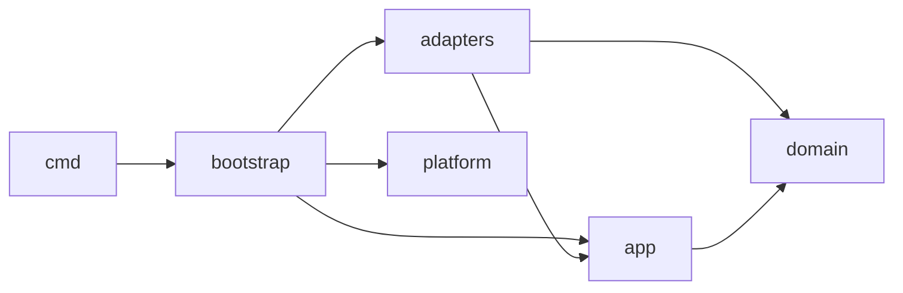
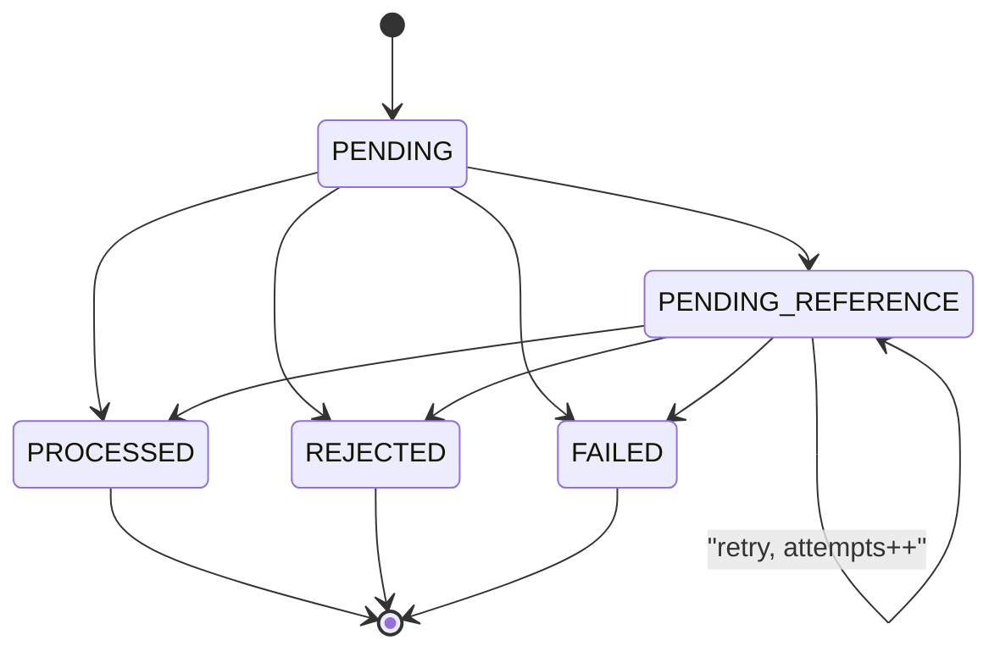

# ARCHITECTURE.md

Documento de decisões de arquitetura. Cada seção traz **Decisão**, **Por quê** e, quando relevante, **Alternativas**. Identificadores de código, tabelas, colunas, códigos de falha e nomes de eventos permanecem em inglês.

Especificação de referência: [docs/CHALLENGE.md](docs/CHALLENGE.md).

---

## 1. Layout de pacotes e direção das dependências

**Decisão**: quatro camadas. Fx fica restrito a `internal/bootstrap` e `cmd/`.

- `internal/domain/...` é Go puro, dependendo só da stdlib e de `google/uuid`. Contém `Money`, `Wallet`, `LedgerEntry`, `WagerTransaction` com sua máquina de estados, `FailureCode`, os eventos e o hash canônico de payload.
- `internal/app/...` contém os casos de uso e as *ports* (interfaces que consome): `TxRunner`, repositórios, `Clock`, `IDGenerator` e `EventPublisher`. Depende apenas de `domain`. HTTP e SQS usam o mesmo caso de uso, `SubmitWagerTransaction`.
- `internal/adapters/...` contém `postgres` (pgx), `httpapi`, `oidc`, `sqsconsumer` e `sqspublisher`. Esses pacotes implementam ports ou acionam casos de uso.
- `internal/platform/...` reúne a infraestrutura transversal: config, logging, métricas, health, runner genérico de workers, clock e idgen. Não depende de `domain`.
- `internal/bootstrap` contém os `fx.Module` e os hooks de lifecycle. É o único pacote de `internal/` que importa `go.uber.org/fx`; fora dele, só `cmd/` o importa (para chamar `fx.New`).



**Por quê**: as dependências apontam para dentro, e o domínio é testável sem infraestrutura. Concentrar o Fx em um único pacote torna o requisito de independência verificável.

**Verificação**: um teste de arquitetura roda `go list -deps ./internal/domain/...` e falha se encontrar `go.uber.org/fx`, `net/http`, `aws-sdk-go-v2`, `pgx` ou `database/sql`. Outro teste garante que `internal/app` não importa `adapters`, e um terceiro garante que só `internal/bootstrap` e `cmd/*` importam fx diretamente.

---

## 2. Money

**Decisão**: `Money{amount int64, currency Currency}`, imutável, com campos não exportados. O `amount` é guardado em unidades mínimas. `Currency` é um código ISO 4217 validado contra uma allow-list (`BRL`, e `USD` apenas para testes de incompatibilidade), todos com escala fixa de 2.

- **Parsing estrito, sem normalização**:
  - O valor precisa casar com `^(0|[1-9][0-9]{0,11})\.[0-9]{2}$`. O parser percorre os dígitos manualmente e nunca usa `strconv.ParseFloat`.
  - São rejeitados: string vazia, sinal (`+`/`-`), espaços, zeros à esquerda, escala diferente de 2 (`25`, `25.5`, `25.000`), notação científica, `NaN` e `Infinity`.
  - A moeda deve ter exatamente 3 letras maiúsculas e estar na allow-list. `brl`, por exemplo, é rejeitado.
- **JSON**: `amount` precisa ser string. Número JSON é rejeitado, o que também impede decodificação via float.
- **Limites**:
  - Entrada externa vai até `999,999,999,999.99` (< 10^14 unidades mínimas).
  - Internamente vale o range completo de `int64`.
- **Overflow**:
  - `Add`, `Sub` e `Neg` são checados e retornam `(Money, error)` com `ErrOverflow`. `Neg(MinInt64)` também é overflow.
  - Moedas diferentes retornam `ErrCurrencyMismatch`.
  - Um crédito que estouraria o saldo é rejeitado com `AMOUNT_OVERFLOW`.
- **Zero value**: `Money{}` é inválido, e os construtores o rejeitam.
- **Serialização**: sempre `{"amount":"25.00","currency":"BRL"}`.
- **Persistência**: `amount_minor BIGINT` + `currency CHAR(3)`, ambos com CHECK.
- **Normalização antes do hash**: desnecessária, porque só a forma canônica é aceita. O hash usa `Money.String()`.

**Alternativas**: `shopspring/decimal` ou `cockroachdb/apd` com `NUMERIC`. Oferecem precisão arbitrária de que não precisamos, com garantias de tipo mais fracas nas bordas.

---

## 3. Acesso ao banco e delimitação de transações

**Decisão**: `pgx/v5` com `pgxpool` e SQL explícito. Migrations com `golang-migrate`, em arquivos `NNNN_name.up.sql`/`.down.sql`, executadas via `cmd/migrate` e por um serviço one-shot no compose.

**Passagem de transação (unit of work explícito)**:
- A port é `TxRunner.InTx(ctx, opts, func(ctx, tx Repos) error) error`.
- `Repos` agrupa `Wallets()`, `Transactions()`, `Ledger()`, `Inbox()` e `Outbox()`, todos ligados a um único `pgx.Tx`.
- Retorno `nil` faz commit; erro ou panic faz rollback.
- `opts` define o nível de isolamento e os valores de `lock_timeout`/`statement_timeout`, aplicados via `SET LOCAL`.

**Isolamento**: `READ COMMITTED` com locks explícitos por padrão. A reconciliação usa `REPEATABLE READ READ ONLY`, para ter um snapshot único.

**Por quê**: a fronteira transacional fica visível em cada caso de uso, e tipos do pgx não vazam para `app`.

**Alternativas**:
- Tx no `context`: implícito e fácil de "escapar" da transação.
- Passar `pgx.Tx` ao `app`: vaza a biblioteca de persistência.
- `sqlc`: opcional para o futuro.

---

## 4. Concorrência por carteira

**Decisão**: lock pessimista com `SELECT ... FROM wallets WHERE id=$1 FOR UPDATE` dentro da transação de negócio, com salvaguardas no banco:
- `CHECK (balance_minor >= 0)`;
- `UPDATE wallets ... WHERE id=$1 AND version=$2`, em que 0 linhas afetadas significa violação de invariante;
- `UNIQUE (wallet_id, wallet_version)` no ledger.

**Invariante de travamento**: toda transição de estado de uma `wager_transaction` acontece com o lock da carteira dessa transação adquirido. Isso vale para o submit, para o worker, para a expiração por TTL e para o registro de `FAILED`. Por isso a leitura da referência **não** usa `FOR UPDATE`: o lock da carteira já serializa qualquer mudança no estado da referência, e o índice único de reversões funciona como salvaguarda.

**Fluxo síncrono (submit HTTP/SQS)**:

0. **Pré-leitura sem lock**: `SELECT player_id, currency FROM wallets WHERE id=$1`, antes de inserir qualquer coisa.
   - Carteira ausente: `WALLET_NOT_FOUND`.
   - Jogador divergente: `PLAYER_WALLET_MISMATCH`.
   - Moeda divergente: `CURRENCY_MISMATCH`.

   Esses três são erros de entrada não persistidos, retornados no lugar de uma violação de FK. A leitura sem lock é segura porque `player_id` e `currency` são imutáveis (há trigger) e carteiras nunca são removidas (há trigger e o papel da aplicação não tem `DELETE`).
1. `BEGIN`. No caso do SQS, `INSERT` na inbox. Em seguida, `INSERT` da própria `wager_transaction` em `PENDING` com `ON CONFLICT DO NOTHING`. Se houver conflito, segue o caminho de idempotência da seção 6.
2. `SELECT wallet FOR UPDATE`.
3. Resolução da referência com um `SELECT` novo, sem lock, executado depois de obter o lock da carteira.
4. O domínio aplica a operação. Depois: `UPDATE` da carteira condicionado à versão, `INSERT` no ledger, `UPDATE` da própria linha para estado terminal ou `PENDING_REFERENCE`, `INSERT` dos eventos na outbox, *nudge* dos dependentes (seção 8) e conclusão da inbox.
5. `COMMIT`.

**Ordem de locks e ausência de deadlock**:
- Submit: índice único da própria linha (e da inbox), depois a carteira.
- Worker: linha reivindicada (`SKIP LOCKED`), depois a carteira.
- Quem detém o lock de uma carteira não espera nenhum lock de linha de `wager_transactions`:
  - a referência é lida sem lock;
  - o nudge usa `FOR UPDATE SKIP LOCKED`;
  - inserts posteriores ao lock (ledger, outbox) usam chaves novas;
  - inserts que podem disputar índice único (transação, inbox) acontecem **antes** do lock da carteira.

  Como cada operação toca uma única carteira, não há ciclo. `40P01` continua classificado como transitório, como rede de segurança.

**Timeouts**: `lock_timeout = 5s`. Os códigos `55P03`, `40P01`, `40001`, erro de conexão e deadline de contexto são tratados como transitórios: rollback e retry.

**Por quê**: o agregado faz a aritmética e produz `balanceBefore`/`balanceAfter`. Com 50 duplicatas em paralelo, o lock enfileira as requisições sem as tempestades de retry do controle otimista. Carteiras distintas não competem entre si.

**Alternativas**:
- Versionamento otimista com retry limitado: muitos aborts em carteiras disputadas.
- `UPDATE ... SET balance = balance - $x WHERE balance >= $x RETURNING`: rápido, mas leva a regra de negócio para o SQL e ainda exige serializar as verificações de reversão.

**Caso 100.00 vs. 2 x 80.00**:
1. T1 e T2 passam pela pré-leitura e inserem suas linhas `PENDING`. Os IDs externos são diferentes, então não há conflito.
2. Ambas executam `SELECT wallet FOR UPDATE`. T1 obtém o lock e T2 espera.
3. T1 debita (100.00 → 20.00), grava o ledger com `DEBIT` na versão 2, marca `PROCESSED` com saldo de resultado 20.00, grava a outbox e faz commit.
4. T2 desbloqueia. Em `READ COMMITTED`, o `FOR UPDATE` relê a versão mais recente (20.00). O domínio devolve `INSUFFICIENT_FUNDS`, e T2 grava `REJECTED`, o evento `WagerTransactionRejected` e nenhum ledger, depois faz commit.
5. Resultado: saldo 20.00, um único débito. Replays devolvem o resultado persistido de cada operação.

---

## 5. Máquina de estados de WagerTransaction



- **Transições**: métodos de domínio `MarkProcessed(result)`, `Reject(code)`, `Fail(code)` e `AwaitReference(next)`. Uma transição inválida retorna `ErrInvalidTransition`. `Rehydrate(...)` restaura o estado sem emitir eventos.
- **Imutabilidade no banco**: um trigger rejeita `UPDATE` quando `OLD.status` é terminal, e também rejeita `DELETE`.
- **Caminho síncrono**: `PENDING` vai a um estado terminal ou a `PENDING_REFERENCE` *na mesma transação*. Não há commit intermediário de aceite, então nunca existe `PENDING` confirmado no banco.
- **Retomado por worker**: apenas `PENDING_REFERENCE`. O worker também busca `PENDING` vencido de forma defensiva.
- **Falha transitória** (não persistida): o rollback desfaz tudo, o HTTP responde 503 e o SQS reentrega. Exemplos:
  - perda de conexão;
  - `40001`, `40P01` e `55P03`;
  - deadline de contexto;
  - erro 5xx ou throttling do SQS.
- **Falha permanente** (`FAILED`, `INTERNAL_INVARIANT_VIOLATION`): violação de invariante que deveria ser impossível, como o CHECK de saldo ou de versão disparando apesar da verificação do domínio, ou um ledger inconsistente.
  - É registrada em uma transação separada após o rollback, adquirindo o lock da carteira para respeitar a invariante da seção 4.
  - Serve para auditoria e gera alerta via métrica.
- **Limitação**: `FAILED` é um beco sem saída para o provedor. Como `(provider_id, external_transaction_id)` é único, a operação não pode ser reenviada com o mesmo ID externo nem com outra chave (retorna `409 EXTERNAL_ID_CONFLICT`). A correção exige intervenção operacional. Isso é aceitável porque `FAILED` só ocorre em violação de invariante interna.

---

## 6. Idempotência

- **`Idempotency-Key`**:
  - Obrigatório no HTTP: sem ele, `400 MISSING_IDEMPOTENCY_KEY`.
  - Formato: de 1 a 255 caracteres ASCII imprimíveis, armazenado exatamente como recebido e nunca recalculado.
  - No SQS, a chave vem de `data.idempotencyKey`.
  - O escopo é por provedor, com `UNIQUE (provider_id, idempotency_key)`.
- **Unicidade financeira**: `UNIQUE (provider_id, external_transaction_id)`.
- **Hash de idempotência**: `SHA-256` sobre JSON canônico, gravado em `payload_hash BYTEA`, com `hash_version = 1`.
  - **Campos**: `providerId`, `externalTransactionId`, `playerId`, `walletId`, `roundId`, `gameId`, `kind`, `money.amount`, `money.currency` e `referenceExternalTransactionId` (omitido quando ausente).
  - **Normalização**: UUIDs em minúsculas na forma canônica; `Money` na forma canônica; strings byte a byte, sem trim (espaços já são rejeitados na validação).
  - **Serialização**: chaves em ordem lexicográfica, sem espaços insignificantes, UTF-8, escape HTML desligado.
  - **Excluídos**: a chave de idempotência, `messageId`, `type`, `occurredAt`, headers e o token.
  - HTTP e SQS montam o mesmo comando de domínio, então produzem o mesmo hash.
- **Algoritmo**: `INSERT ... ON CONFLICT DO NOTHING RETURNING id`, dentro da transação de negócio.
  - Se houver uma duplicata concorrente em andamento, o insert espera no índice único até o commit dela.
  - Sem retorno, busca a linha existente por `(provider, key)` e, se não encontrar, por `(provider, externalId)`.
- **Regras de conflito**:
  - Mesma chave e mesmo hash: replay do resultado persistido, com `idempotentReplay: true` e o mesmo status HTTP da resposta original (seção 13).
  - Mesma chave e hash diferente: `409 IDEMPOTENCY_KEY_CONFLICT`.
  - Chave nova para um `(provider, externalId)` já existente: `409 EXTERNAL_ID_CONFLICT`, **mesmo que o payload seja idêntico**.
- **Saldo no replay**: `result_balance_minor` e `result_wallet_version` são gravados na conclusão, inclusive em `REJECTED`, e devolvidos sem reler a carteira.
- **Erros de entrada** (categoria A, seção 12): não são persistidos. O cliente corrige e reenvia com a mesma chave.
- **Precedência**: a validação sintática e a pré-leitura da carteira acontecem antes da verificação de idempotência. Uma chave reutilizada com payload diferente *e* inválido recebe o erro de entrada, não 409. Um replay legítimo nunca é afetado, porque passa pelas mesmas validações sobre dados imutáveis.

---

## 7. Referências: WIN, REFUND e ROLLBACK

**Tipos de referência permitidos** (qualquer outro: `REFUND`/`ROLLBACK` → `REFERENCE_KIND_NOT_ALLOWED`):
- `WIN` (referência opcional): somente `BET`.
- `REFUND`: somente `BET`.
- `ROLLBACK`: `BET`, `WIN` ou `REFUND`.
- Referência enviada em `BET` ou `LOSS`: erro de entrada `REFERENCE_NOT_ALLOWED`.

**Concordância obrigatória** (senão `REFERENCE_MISMATCH`):
- O provedor é garantido pelo escopo da busca.
- Carteira e rodada precisam coincidir. Jogador e moeda decorrem da carteira.
- Em reversões, o valor precisa ser igual (senão `REFERENCE_AMOUNT_MISMATCH`).
- Em `WIN`, o valor não é comparado.

**Uma reversão por transação referenciada, de qualquer tipo**:
- Garantida pelo índice `UNIQUE (reference_transaction_id) WHERE status='PROCESSED' AND kind IN ('REFUND','ROLLBACK')`.
- Uma segunda reversão recebe `ALREADY_REVERSED`. A verificação acontece sob o lock da carteira, e o índice é a salvaguarda.
- É mais estrito que "não repetir o mesmo tipo" e impede que `REFUND` e `ROLLBACK` devolvam o mesmo débito.
- `ROLLBACK` de um `REFUND` é permitido: referencia o `REFUND`, não a `BET`, e debita de volta. A `BET` continua contando como revertida (pelo `REFUND`), então não pode ser reembolsada de novo. Efeito líquido: a aposta vale.

**ROLLBACK de BET após WIN da mesma rodada**: permitido. São movimentos independentes, e o `WIN` permanece.

**`WIN` não conta como reversão**: vários `WIN` podem referenciar a mesma `BET` (premissa, ver o final do documento).

**Saldo insuficiente**: um `ROLLBACK` de `WIN` ou `REFUND` que deixaria o saldo negativo vira `REJECTED` com `REVERSAL_INSUFFICIENT_FUNDS`, distinto de `INSUFFICIENT_FUNDS`, e fica auditável.

**Estado da referência no momento da avaliação** (vale para `WIN`, `REFUND` e `ROLLBACK`):

| Referência | Resultado |
| --- | --- |
| Ausente | `PENDING_REFERENCE`, com `WagerTransactionPendingReference` emitido uma única vez, na entrada |
| `PENDING_REFERENCE` (por exemplo, `ROLLBACK` de um `REFUND` pendente) | Continua em `PENDING_REFERENCE` até o TTL |
| `REJECTED` ou `FAILED` | `REJECTED` com `REFERENCE_NOT_PROCESSED`, inclusive um `WIN` cuja `BET` foi rejeitada |
| `PROCESSED` | Valida conforme acima e aplica |

**Expiração do TTL** (seção 8):

| Situação no deadline | Código |
| --- | --- |
| Referência nunca apareceu | `REFERENCE_NOT_FOUND` |
| Referência existe mas continua `PENDING_REFERENCE` | `REFERENCE_UNRESOLVED_TIMEOUT` |

---

## 8. Worker de PENDING_REFERENCE

- **Claim**: uma transação por linha:
  1. `SELECT ... WHERE status IN ('PENDING','PENDING_REFERENCE') AND next_attempt_at <= now() ORDER BY next_attempt_at LIMIT 1 FOR UPDATE SKIP LOCKED`;
  2. lock da carteira;
  3. releitura da referência com um statement novo;
  4. aplicar, rejeitar ou reagendar;
  5. commit.

  O lock da linha *é* o claim. Se o processo cair, a transação aborta, o lock é liberado e qualquer instância assume a linha. Não há coluna de lease. São N goroutines por instância.
- **Backoff**: `next = now + min(base * 2^attempts, max)`, com full jitter.
- **TTL**: `reference_deadline_at = created_at + TTL`.
  - Na primeira avaliação após o deadline, se a referência ainda não estiver resolvível, a transação é finalizada como `REJECTED` (`REFERENCE_NOT_FOUND` ou `REFERENCE_UNRESOLVED_TIMEOUT`, seção 7) e emite `WagerTransactionRejected`.
  - Se a referência estiver resolvível no momento da avaliação, a operação é processada mesmo após o deadline.
  - `attempts` serve apenas para métricas.
- **Configuração por env**:

| Variável | Padrão | Testes |
| --- | --- | --- |
| `REFERENCE_TTL` | `10m` | `2s` |
| `REFERENCE_BACKOFF_BASE` | `1s` | |
| `REFERENCE_BACKOFF_MAX` | `60s` | |
| `REFERENCE_WORKER_CONCURRENCY` | `4` | |

- **Nudge** (otimização): quando uma transação chega a `PROCESSED` ou `REJECTED`, a mesma transação SQL antecipa seus dependentes:

  ```sql
  UPDATE wager_transactions SET next_attempt_at = now()
  WHERE id IN (
    SELECT id FROM wager_transactions
    WHERE provider_id = $1 AND reference_external_transaction_id = $2
      AND status = 'PENDING_REFERENCE'
    FOR UPDATE SKIP LOCKED)
  ```

  - **Por que `SKIP LOCKED`**: sem ele, o nudge (que detém o lock da carteira) poderia esperar a linha P, enquanto o worker que detém P espera o lock da carteira. Isso seria um deadlock.
  - **Por que pular é seguro**: uma linha travada está sendo processada por um worker.
    - Se o worker ainda não leu a referência, ele está esperando (ou vai esperar) o lock da carteira que esta transação detém. Ao obtê-lo, relê a referência com um statement novo e enxerga o commit.
    - Se o dependente pertence a outra carteira (e portanto será `REFERENCE_MISMATCH`), perder o nudge só atrasa a resolução até o próximo backoff.

  Pular nunca afeta correção, só latência.
- **Índices**:
  - parcial `(next_attempt_at) WHERE status IN ('PENDING','PENDING_REFERENCE')`;
  - `(provider_id, reference_external_transaction_id) WHERE status='PENDING_REFERENCE'`.

---

## 9. Inbox e outbox

**Inbox** (consumidor SQS):
- Tabela `inbox_messages(consumer_name, message_id, payload_hash, transaction_id, outcome, received_at, processed_at)`, com `PRIMARY KEY (consumer_name, message_id)`.
- **`payload_hash`**: SHA-256 sobre o JSON canônico (mesmas regras da seção 6) dos campos de negócio da seção 6 **mais** `idempotencyKey`.
  - Excluídos: `messageId` (que é a própria chave), `type`, `occurredAt` e todos os metadados de transporte (atributos SQS, `ReceiptHandle`, `ApproximateReceiveCount`).
  - Diferença em relação ao hash de idempotência: inclui a chave, então um `messageId` reaproveitado para outra operação ou outra chave é detectado.
- **Tratamento**:
  - O insert da inbox ocorre no passo 1 da seção 4, antes do lock da carteira.
  - As mudanças de domínio, o ledger, a outbox e `processed_at` são gravados na mesma transação.
  - `messageId` já existente com mesmo hash: duplicata. A mensagem é removida da fila e a métrica de duplicatas é incrementada.
  - `messageId` já existente com hash diferente: mensagem inválida (seção 10).
  - Em `PENDING_REFERENCE`, a inbox é concluída quando a pendência é confirmada, e o worker assume a continuidade.

**Outbox**:
- Tabela `outbox_events(event_id UUID PK, aggregate_type, aggregate_id, event_type, event_version, correlation_id, causation_id, occurred_at, payload JSONB, attempts, next_attempt_at, locked_by, locked_until, last_error, published_at, parked_at)`.
- `payload` é o snapshot completo do envelope.
- Um trigger impede alterar `event_id`, `payload`, `event_type`, `event_version`, `aggregate_id` e `occurred_at`, e impede `DELETE`.
- **`eventId` estável**: UUIDv7 gerado pelo construtor do evento no domínio e persistido no insert. É reutilizado em todas as republicações e também serve de `MessageDeduplicationId` na fila de saída.
- **Claim por lease** (nunca publicar dentro de uma transação):
  1. Transação curta com o `UPDATE` abaixo, seguida de commit.

     ```sql
     UPDATE outbox_events
     SET locked_by = $inst, locked_until = now() + interval '30s', attempts = attempts + 1
     WHERE event_id IN (
       SELECT event_id FROM outbox_events
       WHERE published_at IS NULL AND parked_at IS NULL AND next_attempt_at <= now()
         AND (locked_until IS NULL OR locked_until < now())
       ORDER BY next_attempt_at LIMIT 10
       FOR UPDATE SKIP LOCKED)
     RETURNING ...
     ```

  2. `SendMessageBatch` fora de qualquer transação, com timeout de 5s.
  3. **Resultado por entrada**:
     - Cada entrada em `Successful` recebe `published_at = now()` (`WHERE event_id = $1 AND locked_by = $inst`).
     - Cada entrada em `Failed` recebe `next_attempt_at = now() + min(1s * 2^attempts, 5m) + jitter`, `locked_until = NULL` e `last_error = Code/Message`.
     - Uma falha da chamada inteira (rede, 5xx) reagenda todas as entradas do lote.
  4. **Esgotamento**: com `attempts >= OUTBOX_MAX_ATTEMPTS` (padrão 20), ou com `SenderFault=true` repetido até esse limite, a entrada recebe `parked_at = now()`.
     - A entrada nunca é removida.
     - A métrica `outbox_parked_total` é incrementada e há alerta.
     - O reprocessamento é manual, zerando `parked_at`.
- **Trabalho abandonado**:
  - Lease expirado volta a ser elegível para claim.
  - Uma queda entre a publicação e a marcação causa republicação com o mesmo `eventId`. A entrega é at-least-once, e os consumidores deduplicam por `eventId`.
- **Ordenação**: com vários publishers, ou com uma falha parcial em um lote, a ordem de publicação dentro de um grupo não é garantida. Os consumidores ordenam por `walletVersion`.
- **Índice e métrica**: índice parcial `(next_attempt_at) WHERE published_at IS NULL AND parked_at IS NULL`. O atraso da outbox é medido como `now() - min(occurred_at)` dos não publicados.

---

## 10. SQS

**Entrada**: `wager-transactions.fifo`, com DLQ `wager-transactions-dlq.fifo` e redrive `maxReceiveCount = 10`.
- **`MessageGroupId = walletId`**: ordem por carteira, alinhada ao lock por carteira, com carteiras distintas em paralelo.
  - Alternativa `externalTransactionId`: paralelismo máximo, mas sem ordem.
  - Alternativa `providerId:roundId`: grupos desbalanceados.
- **`MessageDeduplicationId = messageId`**, igual à identidade da inbox. É apenas best effort; as garantias vêm da inbox e das constraints.

**Recepção**:
- Long poll (`WaitTimeSeconds = 20`, `MaxNumberOfMessages = 10`, `AttributeNames = [MessageGroupId, ApproximateReceiveCount]`).
- Mensagens do mesmo grupo em um lote são processadas em sequência; grupos diferentes, em paralelo.
- Visibility timeout de 60s e deadline por mensagem de 15s.

**Ordem no lote após falha transitória**: se a mensagem k do grupo G falhar de forma transitória, as mensagens seguintes de G no mesmo lote **não são processadas**. Elas são liberadas com `ChangeMessageVisibility(0)`. O FIFO não as entrega antes de k enquanto k estiver em voo, então a ordem do grupo é preservada.

**Falha transitória**: a mensagem não é removida. Recebe `ChangeMessageVisibility` com `min(2^ApproximateReceiveCount, 60)` segundos. Depois de 10 recebimentos, o redrive a move para a DLQ.

**Proteção contra indisponibilidade do Postgres**: sem proteção, uma queda curta do banco esgotaria `maxReceiveCount` e mandaria mensagens válidas para a DLQ. Mitigação:
- O consumidor **pausa o polling enquanto a readiness falha**.
  - A readiness checa PG e SQS a cada 2s.
  - Um erro transitório de banco num handler força uma rechecagem imediata.
  - Enquanto pausado, nada é recebido e o contador de recebimentos não avança.
- Apenas mensagens já em voo no momento da queda consomem tentativas.
- O limite de 10 recebimentos com backoff de até 60s dá cerca de 5 minutos de tolerância por mensagem, além da pausa.

**Mensagem inválida ou erro permanente**:
- Inclui:
  - envelope ou JSON inválido;
  - violação de schema ou de `Money`;
  - `kind = OPENING`;
  - hash divergente na inbox;
  - conflito de idempotência ou de ID externo;
  - provedor desconhecido.
- Tratamento: `SendMessage` explícito para a DLQ e, em seguida, `DeleteMessage` na fila de entrada. Nenhum registro de domínio é gravado.
- **Por quê**: esperar o redrive bloquearia o grupo inteiro da carteira por 10 visibility timeouts.
- **Campos do envio à DLQ** (não dependem do envelope):
  - `MessageGroupId` = atributo de sistema `MessageGroupId` da mensagem recebida, sempre presente em FIFO; fallback defensivo: `invalid-messages`.
  - `MessageDeduplicationId` = `MessageId` atribuído pelo SQS à mensagem recebida, estável entre recebimentos. Assim, um envio duplicado por queda entre send e delete é deduplicado na janela de 5 minutos.
  - Atributos `failureClass=PERMANENT`, `failureCode`, `originalMessageId` (do SQS) e `envelopeMessageId` (se parseável).

**Rejeição de negócio**: é commitada como `REJECTED`, e a mensagem é removida.

**Procedimento de redrive da DLQ** (documentado no README):
1. Confirmar que a causa foi resolvida (readiness ok).
2. Mensagens com `failureClass=PERMANENT` exigem correção pelo produtor. **Não** são reenviadas como estão.
3. Mensagens sem esse atributo (vindas do redrive por esgotamento transitório) são reenviadas com a ferramenta `cmd/dlqredrive`:
   - lê da DLQ;
   - faz `SendMessage` para a fila de origem com o mesmo body e o mesmo `MessageGroupId`, e `MessageDeduplicationId = <MessageId>:redrive:<unixSeconds>`;
   - remove da DLQ após o envio.
4. É seguro porque o `messageId` do envelope não muda: a inbox e a idempotência absorvem mensagens que já tinham sido processadas.
5. O `StartMessageMoveTask` da AWS pode ser usado onde houver suporte a FIFO, mas não dependemos dele.

**SIGTERM**: ver a seção 14.

**Saída de eventos**: SQS FIFO `wallet-events.fifo`, com DLQ `wallet-events-dlq.fifo` para consumidores downstream, `MessageGroupId = aggregateId` (`walletId`) e `MessageDeduplicationId = eventId`.

**Controle de acesso no broker**:
- Credenciais separadas para consumidor e publisher.
- Políticas de fila: o consumidor recebe `ReceiveMessage`, `DeleteMessage` e `ChangeMessageVisibility` na entrada, e `SendMessage` na DLQ de entrada. O publisher recebe somente `SendMessage` em `wallet-events.fifo`.
- **Não afirmamos** que o emulador aplica IAM. Há um teste negativo planejado: as credenciais do publisher não conseguem `ReceiveMessage` na entrada.
  - Se o emulador escolhido não aplicar IAM, o teste é marcado como `t.Skip` com a razão explícita, e isso fica registrado como limitação. O emulador adotado é o MiniStack (seção 15); não verificamos ainda se ele aplica IAM.

---

## 11. Autenticação e autorização

**IdP**: Keycloak, realm `wagering`, provisionado por import de realm no compose. Fluxo `client_credentials`.
- Clients `provider-a`, `provider-b` e `wallet-internal`.
- O recurso e a audiência são `wallet-api`.

**Issuer fixo**:
- No compose: `KC_HOSTNAME=http://localhost:8080` (hostname v2) e `KC_HOSTNAME_BACKCHANNEL_DYNAMIC=true`. Os tokens sempre carregam `iss=http://localhost:8080/realms/wagering`, seja o token obtido via `localhost` (host) ou via `keycloak:8080` (rede Docker).
- Na aplicação, o issuer esperado e a URL de JWKS são configurados explicitamente e independentes entre si:
  - `OIDC_ISSUER=http://localhost:8080/realms/wagering`, comparado por igualdade exata;
  - `OIDC_JWKS_URL=http://keycloak:8080/realms/wagering/protocol/openid-connect/certs`, pela rede interna;
  - `OIDC_AUDIENCE=wallet-api`.
- Não há dependência de discovery: usamos `go-oidc/v3` com `NewRemoteKeySet` e `NewVerifier`.
- Nos testes com testcontainers, o app roda no host e obtém tokens pela mesma URL mapeada. O issuer configurado é derivado dessa URL.

**Validação do JWT**:
- Algoritmo: somente RS256.
- Chaves: JWKS com cache e refetch em `kid` desconhecido, com rate limit.
- Claims:
  - `iss` exato;
  - `aud` contém `wallet-api` (via audience mapper);
  - `exp`/`nbf` com leeway de 30s;
  - `azp` presente.
- Falhas retornam `401` com `WWW-Authenticate: Bearer error="invalid_token"`. Tokens nunca são logados.
- Na inicialização, o primeiro fetch do JWKS precisa funcionar (fail fast).

**Permissões**: client roles em `resource_access.wallet-api.roles`.
- `provider`:
  - `POST /wagering/transactions`;
  - `GET /providers/{próprio}/wagering/transactions/*`;
  - `GET /wagering/transactions/{id}` (somente as próprias).

  Não lê carteiras; o saldo só aparece nas respostas das operações.
- `wallet-internal`: `POST /wallets`, `GET /wallets/*`, ledger, reconciliação e leitura de qualquer transação.
- `/health/*` é público.

**providerId vem da identidade**:
- Cada client de provedor tem um mapper de claim fixo `provider_id`, e o principal usa somente essa claim.
- `providerId` no body diferente da claim: `403 PROVIDER_MISMATCH`, sem efeitos.
- `providerId` no path diferente da claim, ou transação de outro provedor: `404`, para não revelar existência.
- Alternativa: usar `azp` como `providerId`. Seria mais simples, mas acopla o nome do client ao domínio.

**Registro de provedores**: a tabela `providers` (seed `provider-a`, `provider-b`) é consultada por HTTP e SQS. Provedor desconhecido ou inativo é rejeitado. Não há vínculo entre provedor e jogador/carteira: qualquer provedor registrado pode operar qualquer carteira.

---

## 12. Códigos de falha (estáveis)

**Categoria A: entrada corrigível**. Não persistida; reenviável com a mesma chave.

| Código | HTTP | Significado |
| --- | --- | --- |
| `INVALID_REQUEST` | 400 | JSON ou schema inválido |
| `MISSING_IDEMPOTENCY_KEY` | 400 | Header ausente |
| `INVALID_MONEY` | 400 | Formato de valor inválido |
| `UNSUPPORTED_CURRENCY` | 400 | Moeda fora da allow-list |
| `UNSUPPORTED_KIND` | 400 | Inclui `OPENING` |
| `INVALID_AMOUNT_FOR_KIND` | 400 | `LOSS` exige `0.00`; os demais tipos, valor > 0 |
| `MISSING_REFERENCE` | 400 | `REFUND`/`ROLLBACK` sem referência |
| `REFERENCE_NOT_ALLOWED` | 400 | Referência em `BET`/`LOSS` |
| `PLAYER_WALLET_MISMATCH` | 400 | Jogador não é o dono da carteira |
| `CURRENCY_MISMATCH` | 400 | Moeda difere da moeda da carteira |
| `WALLET_NOT_FOUND` | 404 | Carteira inexistente |

**Categoria B: rejeição de negócio**. Definitiva, persistida como `REJECTED`, replay idêntico, `422`.

| Código | Significado |
| --- | --- |
| `INSUFFICIENT_FUNDS` | `BET` sem saldo |
| `REVERSAL_INSUFFICIENT_FUNDS` | `ROLLBACK` de `WIN`/`REFUND` sem saldo |
| `REFERENCE_NOT_FOUND` | TTL esgotado e a referência nunca apareceu |
| `REFERENCE_UNRESOLVED_TIMEOUT` | TTL esgotado com a referência ainda em `PENDING_REFERENCE` |
| `REFERENCE_NOT_PROCESSED` | Referência em `REJECTED`/`FAILED` (vale para reversões e para `WIN`) |
| `REFERENCE_KIND_NOT_ALLOWED` | Combinação de tipos inválida |
| `REFERENCE_MISMATCH` | Carteira ou rodada divergentes |
| `REFERENCE_AMOUNT_MISMATCH` | Valor da reversão diferente do valor referenciado |
| `ALREADY_REVERSED` | A referência já tem uma reversão processada |
| `AMOUNT_OVERFLOW` | O crédito estouraria `int64` |

**Categoria C: conflito** (`409`, não persistido como transação): `IDEMPOTENCY_KEY_CONFLICT`, `EXTERNAL_ID_CONFLICT`, `WALLET_ALREADY_EXISTS`.

**Categoria D: falha permanente** (`500`, persistida como `FAILED`): `INTERNAL_INVARIANT_VIOLATION`.

**Categoria E: transitória** (`503`, não persistida, retry): `TEMPORARILY_UNAVAILABLE`.

**Autenticação**: `UNAUTHENTICATED` (401), `FORBIDDEN` (403), `PROVIDER_MISMATCH` (403).

**Em Go**: constantes `domain.FailureCode` e erros tipados (`*domain.RejectionError{Code}`, `*domain.ValidationError{Code}`) ou sentinelas, verificados com `errors.As`/`errors.Is`. O mapeamento para o transporte acontece somente nos adapters.

---

## 13. Mapeamento HTTP

Há dois corpos de resposta:
- **Outcome**: `{transactionId, status, balance?, failureCode?, idempotentReplay}`.
- **Erro**: `{error: {code, message, retryable}}`.

**`POST /wagering/transactions`** (o replay devolve o mesmo status da resposta original, com `idempotentReplay: true`):

| Situação | Status | Corpo |
| --- | --- | --- |
| `PROCESSED` (inclusive `LOSS`) | `200` | Outcome |
| `REJECTED` (categoria B) | `422` | Outcome com `status: "REJECTED"`, `failureCode` e o saldo observado |
| `PENDING_REFERENCE` | `202` | Outcome sem `balance`, com header `Location` apontando para o GET do provedor |
| `FAILED` | `500` | Outcome com `failureCode` |
| Entrada inválida (categoria A) | `400` (`WALLET_NOT_FOUND`: `404`) | Erro |
| Conflito (categoria C) | `409` | Erro |
| Indisponibilidade transitória | `503` | Erro com `retryable: true` e `Retry-After` |
| Autenticação/autorização | `401`/`403` | Erro (recurso de outro provedor: `404`) |

**Outros endpoints**:
- `POST /wallets`: `201`; conflito `409 WALLET_ALREADY_EXISTS`; entrada inválida `400`.
- `GET` de transação: `200` com o recurso, qualquer que seja o status (o `422` vale só para o `POST`); `404` se a transação não existe ou pertence a outro provedor.
- `GET` de carteira e de ledger: `200` ou `404`.
- `POST /wallets/{id}/reconciliation`: `200` mesmo com divergência (`consistent: false`).

---

## 14. Módulos Fx, lifecycle e shutdown

**Módulos** (`internal/bootstrap`): `ConfigModule`, `LoggingModule`, `MetricsModule`, `PostgresModule`, `SQSModule`, `AuthModule`, `RepositoryModule`, `AppModule`, `HTTPModule`, `ConsumerModule`, `OutboxRelayModule`, `ReferenceWorkerModule`, `HealthModule`.
- `fx.Provide` registra apenas construtores, e os hooks são registrados via `fx.Invoke`.
- Papéis ativáveis por env (`RUN_HTTP`, `RUN_CONSUMER`, `RUN_OUTBOX`, `RUN_REFERENCE_WORKER`), todos ligados por padrão, em um binário único.

**OnStart** (ordem de registro):
1. Validar a configuração (fail fast).
2. Ping no pool e verificação da versão do schema.
3. Primeiro fetch do JWKS.
4. Resolver as URLs das filas.
5. Iniciar o loop de readiness.
6. Iniciar o hook "runners": reference worker, outbox relay, consumidor e servidor HTTP.

Workers usam o seu próprio `context.WithCancel(context.Background())`, não o contexto do OnStart.

**OnStop**: `fx.StopTimeout(30s)` e `stop_grace_period: 35s` no compose. Fx executa os hooks em ordem reversa, então o hook "runners", registrado depois do pool, para primeiro. Dentro dele, os componentes param **concorrentemente**:

| Tempo | Etapa |
| --- | --- |
| 0s | Readiness passa a `draining` (`/health/ready` retorna 503) e o consumidor para de fazer polling |
| 0s a 2s | `READINESS_DRAIN_DELAY = 2s`, para que balanceadores percebam o draining |
| 2s a 22s | Grupo paralelo com orçamento de 20s, aguardado por `errgroup` (detalhes abaixo) |
| até 25s | `pool.Close()`, com até 3s |
| até 26s | Flush de logs e métricas, com até 1s |

Componentes do grupo paralelo:
- `http.Server.Shutdown(ctx)`: requisições em andamento terminam; o timeout de handler é de 10s.
- Consumidor:
  - Handlers em voo têm deadline de 15s.
  - Mensagens recebidas e não iniciadas são liberadas com `ChangeMessageVisibility(0)`.
  - Handlers que estourarem o deadline fazem rollback e liberam a visibilidade.
- Reference worker: cancela o loop. Cada iteração tem `statement_timeout`/contexto de 10s; um rollback libera a linha.
- Outbox relay: cancela o loop. O publish em andamento tem timeout de 5s. Se a marcação não acontecer, o lease expira e há republicação com o mesmo `eventId`.

**Total**: 26s ou menos, dentro dos 30s.

O término é observável: cada worker loga `stopped` com contadores e fecha um canal `done`. Um teste de integração do Fx verifica start e stop e a ausência de goroutines vazadas (`goleak`).

---

## Árvore de diretórios

```
cmd/
  wallet/            # fx.New(bootstrap.Modules...).Run()
  migrate/           # up | down | version
  dlqredrive/        # reenvio controlado da DLQ (seção 10)
internal/
  domain/
    money/           # Money, Currency, parser estrito
    wallet/          # agregado Wallet, LedgerEntry
    wager/           # WagerTransaction, Kind, Status, transições, FailureCode, PayloadHash
    event/           # envelope + eventos concretos e construtores
  app/
    ports.go         # TxRunner, Repos, Clock, IDGenerator, EventPublisher
    wagering/        # SubmitWagerTransaction, ResolvePendingReference, consultas
    wallets/         # OpenWallet, GetWallet, ListLedger, Reconcile
    messaging/       # HandleInboundMessage (inbox), RelayOutbox
    authz/           # Principal, checagem de permissões
  adapters/
    postgres/        # pool, TxRunner, repositórios, classificação de erros pg
    httpapi/         # router, handlers, DTOs, mapeamento de erros, middleware de auth
    oidc/            # verificador de tokens
    sqsconsumer/
    sqspublisher/
  platform/
    config/ logging/ metrics/ health/ worker/ clock/ idgen/
  bootstrap/         # módulos Fx + hooks de lifecycle
migrations/          # NNNN_name.up.sql / .down.sql + embed.go (go:embed)
deploy/
  keycloak/realm-wagering.json
  ministack/init-queues.sh
  postgres/init/01-roles.sh
test/
  integration/       # //go:build integration — testcontainers (PG, Keycloak, LocalStack)
  multiinstance/     # //go:build multiinstance — 3 processos via compose
docker-compose.yml  Dockerfile  .env.example  README.md  ARCHITECTURE.md
```

Versão do Go: a última estável no momento da implementação, fixada em `go.mod` e no Dockerfile (seção 15).

---

## 15. Decisões do slice 1 (esqueleto e infraestrutura)

**Versões fixadas** (verificadas em 2026-10-16):

| Item | Versão |
| --- | --- |
| Go (`go.mod`, Dockerfile) | `1.27.2`, imagem `golang:1.27.2-alpine3.24` |
| Imagem de runtime | `gcr.io/distroless/static-debian13:nonroot` (binários estáticos, `CGO_ENABLED=0`) |
| PostgreSQL | `postgres:18.6-alpine3.24` (compose e testcontainers) |
| Keycloak | `quay.io/keycloak/keycloak:26.7.5` |
| Emulador SQS | `ministackorg/ministack:1.5.27` |
| Bibliotecas | `go.uber.org/fx v1.24.0`, `jackc/pgx/v5 v5.11.0`, `golang-migrate/migrate/v4 v4.20.1`, `caarlos0/env/v11 v11.4.1`, `golang.org/x/sync` (errgroup), `go.uber.org/goleak v1.3.0`, `testcontainers-go v0.44.0` |

**MiniStack no lugar do LocalStack**: desde março de 2026 a imagem do LocalStack exige `LOCALSTACK_AUTH_TOKEN`. O MiniStack é MIT, roda sem token, é compatível com a API SQS (FIFO e DLQ) e executa scripts de `/etc/localstack/init/ready.d` com `sh`. O script `deploy/ministack/init-queues.sh` usa o `aws` CLI incluído na imagem e grava `/tmp/wager-queues-ready` ao terminar; o healthcheck do compose só passa com esse marcador.

**Configuração das filas** (o que a seção 10 não fixava):
- Todas FIFO, com `ContentBasedDeduplication=false` (o produtor sempre envia `MessageDeduplicationId`).
- `wager-transactions.fifo`: visibility 60s, retenção 4 dias, redrive para a DLQ após 10 recebimentos.
- `wallet-events.fifo`: visibility 30s (consumidor downstream), retenção 4 dias, redrive para `wallet-events-dlq.fifo` após 10 recebimentos.
- DLQs: retenção de 14 dias (maior que a da fila de origem, como a AWS exige para preservar a idade da mensagem).

**Portas**: o Keycloak precisa da 8080 no host para manter o issuer fixo (seção 11). Por isso a aplicação escuta em `:8081` (`HTTP_ADDR`).

**Papéis do banco**: `deploy/postgres/init/01-roles.sh` roda na primeira inicialização do Postgres, no compose e nos testes de integração. Ele:
- cria `wallet_owner` (dono do banco `wallet` e do schema `public`) e `wallet_app` (sem `CREATEDB`/`CREATEROLE`, só `CONNECT` e `USAGE`);
- revoga os privilégios de `PUBLIC` no banco e no schema;
- define `ALTER DEFAULT PRIVILEGES FOR ROLE wallet_owner ... GRANT SELECT ON TABLES TO wallet_app`. O único privilégio padrão é `SELECT`, de que o app precisa para checar a versão do schema. `INSERT`/`UPDATE` são concedidos tabela a tabela pelas migrations de schema.

**Migrations embutidas**: `migrations/embed.go` embute os `.sql` via `go:embed`. `cmd/migrate` (fonte `iofs`, driver `pgx5://`) e a checagem de startup usam o mesmo conjunto. `cmd/migrate down [N]` reverte N passos (padrão 1). `force` não é exposto: reparar uma migration suja é um procedimento manual documentado no README. A `0001_init` cria apenas `schema_info` (uma linha) para provar `up` e `down`; o schema real começa na `0002`.

**Checagem da versão do schema no startup** (passo 2 da seção 14): o app lê `schema_migrations` e falha se a tabela não existir, se estiver `dirty` ou se a versão for **menor** que a última migration embutida. Uma versão **maior** é aceita e logada, para que instâncias antigas continuem rodando durante um deploy com migrations expand/contract.

**Configuração**: `caarlos0/env/v11` com tags na struct `config.Config` e um `Validate()` que reporta todos os erros juntos, citando o nome da variável de ambiente. Os orçamentos da seção 14 que não variam por ambiente ficam como constantes em `internal/bootstrap`: `fx.StopTimeout(30s)`, grupo paralelo de 20s e fechamento do pool em 3s. O handler timeout (10s) e o drain delay (2s) são configuráveis.

**Logs**: `log/slog` com `JSONHandler` em stdout. Os eventos do próprio Fx também saem em JSON (`fxevent.SlogLogger`). O handler de stdout não bufferiza, então o passo "flush de logs" da seção 14 não precisa de código; ele volta com as métricas.

**Health**:
- `/health/live` responde sempre 200, sem tocar dependências.
- `/health/ready` serve o snapshot de um loop em background (`READINESS_INTERVAL=2s`, timeout de 1s por check). Antes da primeira rodada o estado é `pending` (503). Durante o draining a resposta é 503 com `status: "draining"`.
- O corpo expõe só `ok`/`fail`/`pending` por check; o detalhe do erro vai para o log, porque o endpoint é público.
- O check de SQS entra no slice de SQS.

**Roteador**: `net/http.ServeMux` com padrões de método (`GET /health/live`), envolvido por `http.TimeoutHandler` com o handler timeout.

**Hook "runners"**: no slice 1 ele só contém o servidor HTTP. O listen é síncrono no `OnStart`, então porta ocupada falha o start. Os papéis `RUN_CONSUMER`, `RUN_OUTBOX` e `RUN_REFERENCE_WORKER` existem na config e só logam "not implemented yet".

**Falha no start**: o Fx não chama `OnStop` de um hook cujo `OnStart` falhou. Por isso o hook do Postgres fecha o pool no próprio caminho de erro. O teste de integração verifica isso com `goleak`.

**Imagem única**: o Dockerfile gera `/app/wallet` e `/app/migrate`; o serviço `migrate` do compose sobrescreve o entrypoint. A imagem distroless não tem shell, então o serviço `app` não tem healthcheck no compose (nenhum serviço depende dele); a prontidão é observada via `/health/ready` no host.

---

## Esboço do schema

**`providers`**: `provider_id TEXT PK`, `active BOOL NOT NULL`.

**`wallets`**:
- Colunas: `id UUID PK`, `player_id UUID NOT NULL`, `currency CHAR(3) NOT NULL CHECK (currency ~ '^[A-Z]{3}$')`, `balance_minor BIGINT NOT NULL CHECK (balance_minor >= 0)`, `version BIGINT NOT NULL CHECK (version >= 1)`, `created_at`, `updated_at`.
- Unicidade: `UNIQUE (player_id, currency)`, e `UNIQUE (id, currency)` como alvo de FK composta.
- Trigger: impede alterar `id`, `player_id`, `currency` e `created_at`, e impede `DELETE`. É o que garante a pré-leitura da seção 4.

**`wager_transactions`**:
- **Colunas**:
  - `id UUID PK`;
  - `origin TEXT CHECK IN ('INTERNAL','EXTERNAL')`;
  - `kind` e `status`, com CHECK dos enums;
  - `wallet_id` e `currency`, com FK `(wallet_id, currency) → wallets(id, currency)`;
  - `player_id`;
  - `amount_minor BIGINT CHECK (>= 0)`;
  - `provider_id` (FK para `providers`), `external_transaction_id`, `idempotency_key`, `payload_hash BYTEA`, `hash_version SMALLINT`;
  - `round_id`, `game_id`;
  - `reference_external_transaction_id`, `reference_transaction_id UUID` (FK para a própria tabela);
  - `failure_code`, `result_balance_minor`, `result_wallet_version`;
  - `attempts`, `next_attempt_at`, `reference_deadline_at`;
  - `correlation_id`, `created_at`, `updated_at`, `completed_at`.
- **CHECKs**:
  - Forma por origem:
    - `INTERNAL`: `kind = 'OPENING'` e campos externos `NULL`.
    - `EXTERNAL`: `kind <> 'OPENING'` e campos externos `NOT NULL`.
  - Valores:
    - `LOSS`: `amount_minor = 0`.
    - Demais tipos: `amount_minor > 0`.
  - Referências:
    - `REFUND`/`ROLLBACK` exigem referência.
    - Apenas `WIN`/`REFUND`/`ROLLBACK` podem ter referência.
  - `failure_code IS NOT NULL` se e somente se `status IN ('REJECTED','FAILED')`.
  - `REJECTED`/`PROCESSED` exigem `result_balance_minor` e `result_wallet_version`.
- **Unicidade**:
  - `UNIQUE (provider_id, external_transaction_id)`;
  - `UNIQUE (provider_id, idempotency_key)`;
  - (NULLs distintos, o que não afeta linhas internas);
  - `UNIQUE (wallet_id) WHERE kind = 'OPENING'`, que impede crédito inicial duplicado;
  - `UNIQUE (reference_transaction_id) WHERE status = 'PROCESSED' AND kind IN ('REFUND','ROLLBACK')`.
- **Índices** (seção 8):
  - parcial `(next_attempt_at) WHERE status IN ('PENDING','PENDING_REFERENCE')`;
  - `(provider_id, reference_external_transaction_id) WHERE status = 'PENDING_REFERENCE'`.
- **Trigger**: rejeita `UPDATE` quando `OLD.status` é terminal, e rejeita `DELETE`.

**`wallet_ledger_entries`**:
- Colunas: `id UUID PK`, `wallet_id` e `currency` (FK composta para `wallets`), `transaction_id UUID FK`, `direction CHECK IN ('DEBIT','CREDIT')`, `amount_minor BIGINT CHECK (> 0)`, `balance_before_minor CHECK (>= 0)`, `balance_after_minor CHECK (>= 0)`, `wallet_version BIGINT`, `created_at`.
- `CHECK (balance_after_minor = balance_before_minor + CASE direction WHEN 'CREDIT' THEN amount_minor ELSE -amount_minor END)`.
- `UNIQUE (wallet_id, transaction_id)`.
- `UNIQUE (wallet_id, wallet_version)`. O cursor de paginação é o `wallet_version` codificado em base64 opaco, com ordem estável.

**`inbox_messages`** e **`outbox_events`**: conforme a seção 9.

**Imutabilidade do ledger** (defesa em profundidade):
1. Trigger `BEFORE UPDATE OR DELETE` por linha e trigger `BEFORE TRUNCATE` por statement, ambos com `RAISE EXCEPTION`.
2. Privilégios: migrations rodam como `wallet_owner`; a aplicação conecta como `wallet_app`.
   - No ledger, `wallet_app` tem somente `SELECT` e `INSERT`.
   - Nas demais tabelas, `SELECT`, `INSERT` e `UPDATE`, sem `DELETE` nem `TRUNCATE`.
3. Testes de integração verificam que `UPDATE` e `DELETE` falham mesmo executados como owner, o que exercita o trigger.

---

## Decisões registradas (antigas questões abertas)

- **Rejeição de negócio no HTTP**: `422` com o corpo de outcome. O replay devolve o mesmo status.
- **`WIN` com referência**: a referência deve ser uma `BET` `PROCESSED` do mesmo provedor, carteira e rodada. Se estiver ausente, o `WIN` vai para `PENDING_REFERENCE`.
- **`ROLLBACK` de `BET` após `WIN` da rodada**: permitido.
- **Mesmo `(providerId, externalTransactionId)` com outra chave**: `409 EXTERNAL_ID_CONFLICT`, mesmo com payload idêntico.
- **Formato de Money**: estrito, conforme a seção 2.
- **Moedas**: BRL, e USD apenas para testes de incompatibilidade.
- **Vínculo entre provedor e carteira**: nenhum, com registro de provedores.
- **Permissões de leitura**:
  - O serviço interno lê qualquer transação.
  - Provedores não leem carteiras.
- **Erros de carteira, jogador e moeda**: erros de entrada não persistidos.
- **TTL e backoff**: padrões mantidos, configuráveis por env. Os testes usam TTL de 2s.
- **Destino dos eventos**: SQS FIFO `wallet-events.fifo`.
- **IAM no emulador**: não afirmamos enforcement. Há um teste negativo, e o resultado é documentado com honestidade.
- **Idioma**: documento em português, identificadores em inglês.

---

## Premissas e limitações

- **`FAILED` é terminal e bloqueia o `externalTransactionId`** (seção 5). Exige intervenção operacional.
- **Existência de carteira observável por provedores**: `WALLET_NOT_FOUND` (404) e `PLAYER_WALLET_MISMATCH` permitem que um provedor autenticado descubra se um `walletId` existe. O risco é aceito porque os IDs são UUIDv7 não sequenciais e o provedor já precisa conhecer a carteira para operar.
- **Vários `WIN` podem referenciar a mesma `BET`**, e o valor do `WIN` não é comparado ao da aposta.
- **Precedência de erros**: erro de entrada prevalece sobre conflito de idempotência (seção 6).
- **Ordem dos eventos de saída**: não é garantida entre publishers. Os consumidores usam `walletVersion`.
- **IAM no emulador**: pode não ser aplicado; nesse caso, o teste negativo é pulado com justificativa.
- **`StartMessageMoveTask`**: o suporte a FIFO no emulador não é garantido. Usamos `cmd/dlqredrive`.
- **Retenção**: sem limpeza de `inbox_messages` e `outbox_events` publicados neste escopo, já que a aplicação não tem `DELETE`. Uma rotina de retenção ficaria para trabalho futuro, executada com outro papel.
- **Keycloak em testcontainers**: o issuer é a URL mapeada no host, sem `KC_HOSTNAME` fixo.
