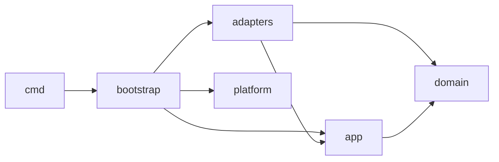
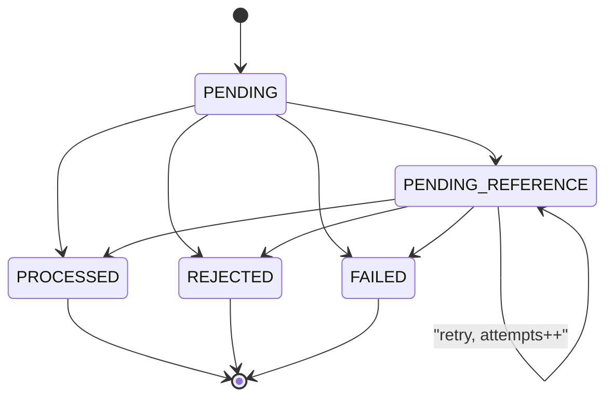

# ARCHITECTURE.md

Documento de decisões de arquitetura. Cada seção traz **Decisão**, **Por quê** e, quando relevante, **Alternativas**. Identificadores de código, tabelas, colunas, códigos de falha e nomes de eventos permanecem em inglês.

Especificação de referência: [docs/CHALLENGE.md](docs/CHALLENGE.md).

---

## 1. Layout de pacotes e direção das dependências

**Decisão**: quatro camadas. Fx fica restrito a `internal/bootstrap` e `cmd/`.

- `internal/domain/...` é Go puro, dependendo só da stdlib e de `google/uuid`. Contém `Money`, `Wallet`, `LedgerEntry`, `WagerTransaction` com sua máquina de estados, `FailureCode`, os eventos e o hash canônico de payload.
- `internal/app/...` contém os casos de uso e as *ports* (interfaces que consome): `TxRunner`, repositórios, `Clock`, `IDGenerator` e `EventPublisher`. Depende apenas de `domain`. HTTP e SQS usam o mesmo caso de uso, `SubmitWagerTransaction`.
- `internal/adapters/...` contém `postgres` (pgx), `httpapi`, `oidc`, `sqsconsumer` e `sqspublisher`. Esses pacotes implementam ports ou acionam casos de uso.
- `internal/platform/...` reúne a infraestrutura transversal: config, logging, métricas, health, runner genérico de workers, clock e idgen. Não depende de `domain`.
- `internal/bootstrap` contém os `fx.Module` e os hooks de lifecycle. É o único pacote de `internal/` que importa `go.uber.org/fx`; fora dele, só `cmd/` o importa (para chamar `fx.New`).



**Por quê**: as dependências apontam para dentro, e o domínio é testável sem infraestrutura. Concentrar o Fx em um único pacote torna o requisito de independência verificável.

**Verificação**: um teste de arquitetura roda `go list -deps ./internal/domain/...` e falha se encontrar `go.uber.org/fx`, `net/http`, `aws-sdk-go-v2`, `pgx` ou `database/sql`. Outro teste garante que `internal/app` não importa `adapters`, e um terceiro garante que só `internal/bootstrap` e `cmd/*` importam fx diretamente.

---

## 2. Money

**Decisão**: `Money{amount int64, currency Currency}`, imutável, com campos não exportados. O `amount` é guardado em unidades mínimas. `Currency` é um código ISO 4217 validado contra uma allow-list (`BRL`, e `USD` apenas para testes de incompatibilidade), todos com escala fixa de 2.

- **Parsing estrito, sem normalização**:
  - O valor precisa casar com `^(0|[1-9][0-9]{0,11})\.[0-9]{2}$`. O parser percorre os dígitos manualmente e nunca usa `strconv.ParseFloat`.
  - São rejeitados: string vazia, sinal (`+`/`-`), espaços, zeros à esquerda, escala diferente de 2 (`25`, `25.5`, `25.000`), notação científica, `NaN` e `Infinity`.
  - A moeda deve ter exatamente 3 letras maiúsculas e estar na allow-list. `brl`, por exemplo, é rejeitado.
- **JSON**: `amount` precisa ser string. Número JSON é rejeitado, o que também impede decodificação via float.
- **Limites**:
  - Entrada externa vai até `999,999,999,999.99` (< 10^14 unidades mínimas).
  - Internamente vale o range completo de `int64`.
- **Overflow**:
  - `Add`, `Sub` e `Neg` são checados e retornam `(Money, error)` com `ErrOverflow`. `Neg(MinInt64)` também é overflow.
  - Moedas diferentes retornam `ErrCurrencyMismatch`.
  - Um crédito que estouraria o saldo é rejeitado com `AMOUNT_OVERFLOW`.
- **Zero value**: `Money{}` é inválido, e os construtores o rejeitam.
- **Serialização**: sempre `{"amount":"25.00","currency":"BRL"}`.
- **Persistência**: `amount_minor BIGINT` + `currency CHAR(3)`, ambos com CHECK.
- **Normalização antes do hash**: desnecessária, porque só a forma canônica é aceita. O hash usa `Money.String()`.

**Alternativas**: `shopspring/decimal` ou `cockroachdb/apd` com `NUMERIC`. Oferecem precisão arbitrária de que não precisamos, com garantias de tipo mais fracas nas bordas.

---

## 3. Acesso ao banco e delimitação de transações

**Decisão**: `pgx/v5` com `pgxpool` e SQL explícito. Migrations com `golang-migrate`, em arquivos `NNNN_name.up.sql`/`.down.sql`, executadas via `cmd/migrate` e por um serviço one-shot no compose.

**Passagem de transação (unit of work explícito)**:
- A port é `TxRunner.InTx(ctx, opts, func(ctx, tx Repos) error) error`.
- `Repos` agrupa `Wallets()`, `Transactions()`, `Ledger()`, `Inbox()` e `Outbox()`, todos ligados a um único `pgx.Tx`.
- Retorno `nil` faz commit; erro ou panic faz rollback.
- `opts` define o nível de isolamento e os valores de `lock_timeout`/`statement_timeout`, aplicados via `SET LOCAL`.

**Isolamento**: `READ COMMITTED` com locks explícitos por padrão. A reconciliação usa `REPEATABLE READ READ ONLY`, para ter um snapshot único.

**Por quê**: a fronteira transacional fica visível em cada caso de uso, e tipos do pgx não vazam para `app`.

**Alternativas**:
- Tx no `context`: implícito e fácil de "escapar" da transação.
- Passar `pgx.Tx` ao `app`: vaza a biblioteca de persistência.
- `sqlc`: opcional para o futuro.

---

## 4. Concorrência por carteira

**Decisão**: lock pessimista com `SELECT ... FROM wallets WHERE id=$1 FOR NO KEY UPDATE` dentro da transação de negócio, com salvaguardas no banco:
- `CHECK (balance_minor >= 0)`;
- `UPDATE wallets ... WHERE id=$1 AND version=$2`, em que 0 linhas afetadas significa violação de invariante;
- `UNIQUE (wallet_id, wallet_version)` no ledger;
- trigger de restrição adiado `wallets_ledger_link`: toda mudança de saldo só commita com o seu lançamento no ledger (seção 16).

**Invariante de travamento**: toda transição de estado de uma `wager_transaction` acontece com o lock da carteira dessa transação adquirido. Isso vale para o submit, para o worker, para a expiração por TTL e para o registro de `FAILED`. Por isso a leitura da referência **não** usa `FOR UPDATE`: o lock da carteira já serializa qualquer mudança no estado da referência, e o índice único de reversões funciona como salvaguarda.

**Fluxo síncrono (submit HTTP/SQS)**:

0. **Pré-leitura sem lock**: `SELECT player_id, currency FROM wallets WHERE id=$1`, antes de inserir qualquer coisa.
   - Carteira ausente: `WALLET_NOT_FOUND`.
   - Jogador divergente: `PLAYER_WALLET_MISMATCH`.
   - Moeda divergente: `CURRENCY_MISMATCH`.

   Esses três são erros de entrada não persistidos, retornados no lugar de uma violação de FK. A leitura sem lock é segura porque `player_id` e `currency` são imutáveis (há trigger) e carteiras nunca são removidas (há trigger e o papel da aplicação não tem `DELETE`).
1. `BEGIN`. No caso do SQS, `INSERT` na inbox. Em seguida, `INSERT` da própria `wager_transaction` em `PENDING` com `ON CONFLICT DO NOTHING`. Se houver conflito, segue o caminho de idempotência da seção 6.
2. `SELECT wallet FOR NO KEY UPDATE`.
3. Resolução da referência com um `SELECT` novo, sem lock, executado depois de obter o lock da carteira.
4. O domínio aplica a operação. Depois: `UPDATE` da carteira condicionado à versão, `INSERT` no ledger, `UPDATE` da própria linha para estado terminal ou `PENDING_REFERENCE`, `INSERT` dos eventos na outbox, *nudge* dos dependentes (seção 8) e conclusão da inbox.
5. `COMMIT`.

**Ordem de locks e ausência de deadlock**:
- Submit: índice único da própria linha (e da inbox), depois a carteira.
- Worker: linha reivindicada (`SKIP LOCKED`), depois a carteira.
- Quem detém o lock de uma carteira não espera nenhum lock de linha de `wager_transactions`:
  - a referência é lida sem lock;
  - o nudge usa `FOR UPDATE SKIP LOCKED`;
  - inserts posteriores ao lock (ledger, outbox) usam chaves novas;
  - inserts que podem disputar índice único (transação, inbox) acontecem **antes** do lock da carteira.

  Como cada operação toca uma única carteira, não há ciclo. `40P01` continua classificado como transitório, como rede de segurança.

**Por que `FOR NO KEY UPDATE` e não `FOR UPDATE`** (corrigido no slice 6): o `INSERT` da própria linha no passo 1 verifica a FK `wager_transactions → wallets`, e essa verificação toma `FOR KEY SHARE` na linha da carteira até o fim da transação. `FOR UPDATE` conflita com `FOR KEY SHARE`; `FOR NO KEY UPDATE` não. Com `FOR UPDATE`, duas operações diferentes na mesma carteira inseriam suas linhas (cada uma com `KEY SHARE` na carteira) e depois esperavam uma pela outra no passo 2: deadlock em 35 de 40 disputas medidas, com uma das apostas do caso 100.00 vs. 2 x 80.00 recebendo 503 em vez de `INSUFFICIENT_FUNDS`. O argumento acima, de que inserts antes do lock só disputam índices únicos, ignorava esse lock da FK. `FOR NO KEY UPDATE` continua sendo lock pessimista por carteira (conflita consigo mesmo, então escritores da mesma carteira entram em fila) e é o lock que o próprio Postgres toma num `UPDATE` de colunas que não são chave, como o do saldo. O que `FOR UPDATE` acrescentaria é proteção contra `DELETE` ou alteração de chave da carteira, já proibidos por trigger. O teste `TestNoDeadlockBetweenOperationsOnOneWallet` disputa duas operações na mesma carteira 40 vezes e exige zero `40P01`; ele falha se o lock voltar a ser `FOR UPDATE`.

**Timeouts**: `lock_timeout = 5s` e `statement_timeout = 10s` (padrão de toda transação, seção 24). Os códigos `55P03`, `40P01`, `40001`, `57014` (comando cancelado, seção 24), erro de conexão e deadline de contexto são tratados como transitórios: rollback e retry.

**Por quê**: o agregado faz a aritmética e produz `balanceBefore`/`balanceAfter`. Com 50 duplicatas em paralelo, o lock enfileira as requisições sem as tempestades de retry do controle otimista. Carteiras distintas não competem entre si.

**Alternativas**:
- Versionamento otimista com retry limitado: muitos aborts em carteiras disputadas.
- `UPDATE ... SET balance = balance - $x WHERE balance >= $x RETURNING`: rápido, mas leva a regra de negócio para o SQL e ainda exige serializar as verificações de reversão.

**Caso 100.00 vs. 2 x 80.00**:
1. T1 e T2 passam pela pré-leitura e inserem suas linhas `PENDING`. Os IDs externos são diferentes, então não há conflito.
2. Ambas executam `SELECT wallet FOR NO KEY UPDATE`. T1 obtém o lock e T2 espera.
3. T1 debita (100.00 → 20.00), grava o ledger com `DEBIT` na versão 2, marca `PROCESSED` com saldo de resultado 20.00, grava a outbox e faz commit.
4. T2 desbloqueia. Em `READ COMMITTED`, o `FOR NO KEY UPDATE` relê a versão mais recente (20.00). O domínio devolve `INSUFFICIENT_FUNDS`, e T2 grava `REJECTED`, o evento `WagerTransactionRejected` e nenhum ledger, depois faz commit.
5. Resultado: saldo 20.00, um único débito. Replays devolvem o resultado persistido de cada operação.

---

## 5. Máquina de estados de WagerTransaction



- **Transições**: métodos de domínio `MarkProcessed(result)`, `Reject(code)`, `Fail(code)` e `AwaitReference(next)`. Uma transição inválida retorna `ErrInvalidTransition`. `Rehydrate(...)` restaura o estado sem emitir eventos.
- **Imutabilidade no banco**: um trigger rejeita `UPDATE` quando `OLD.status` é terminal, e também rejeita `DELETE`.
- **Caminho síncrono**: `PENDING` vai a um estado terminal ou a `PENDING_REFERENCE` *na mesma transação*. Não há commit intermediário de aceite, então nunca existe `PENDING` confirmado no banco.
- **Retomado por worker**: apenas `PENDING_REFERENCE`. O worker também busca `PENDING` vencido de forma defensiva.
- **Falha transitória** (não persistida): o rollback desfaz tudo, o HTTP responde 503 e o SQS reentrega. Exemplos:
  - perda de conexão;
  - `40001`, `40P01` e `55P03`;
  - deadline de contexto;
  - erro 5xx ou throttling do SQS.
- **Falha permanente** (`FAILED`, `INTERNAL_INVARIANT_VIOLATION`): violação de invariante que deveria ser impossível, como o CHECK de saldo ou de versão disparando apesar da verificação do domínio, um ledger inconsistente, ou o próprio domínio recusando a operação com `ErrInvalidTransaction` ou `ErrInvalidTransition` (por exemplo, uma carteira travada que não é a da transação). O submit e o worker tratam todos do mesmo jeito.
  - É registrada em uma transação separada após o rollback, adquirindo o lock da carteira para respeitar a invariante da seção 4.
  - Serve para auditoria e gera alerta via métrica.
  - Se nem o `FAILED` puder ser gravado, nada é persistido e a falha continua sendo de categoria D: o HTTP responde `500 INTERNAL_INVARIANT_VIOLATION` (não retryable) e o SQS manda a mensagem para a DLQ com `failureClass=PERMANENT` e esse código. Uma gravação que falhou de forma transitória continua sendo retry no SQS.
- **Limitação**: `FAILED` é um beco sem saída para o provedor. Como `(provider_id, external_transaction_id)` é único, a operação não pode ser reenviada com o mesmo ID externo nem com outra chave (retorna `409 EXTERNAL_ID_CONFLICT`). A correção exige intervenção operacional. Isso é aceitável porque `FAILED` só ocorre em violação de invariante interna.

---

## 6. Idempotência

- **`Idempotency-Key`**:
  - Obrigatório no HTTP: sem ele, `400 MISSING_IDEMPOTENCY_KEY`.
  - Formato: de 1 a 255 caracteres ASCII imprimíveis, armazenado exatamente como recebido e nunca recalculado.
  - No SQS, a chave vem de `data.idempotencyKey`.
  - O escopo é por provedor, com `UNIQUE (provider_id, idempotency_key)`.
- **Unicidade financeira**: `UNIQUE (provider_id, external_transaction_id)`.
- **Hash de idempotência**: `SHA-256` sobre JSON canônico, gravado em `payload_hash BYTEA`, com `hash_version = 1`.
  - **Campos**: `providerId`, `externalTransactionId`, `playerId`, `walletId`, `roundId`, `gameId`, `kind`, `money.amount`, `money.currency` e `referenceExternalTransactionId` (omitido quando ausente).
  - **Normalização**: UUIDs em minúsculas na forma canônica; `Money` na forma canônica; strings byte a byte, sem trim (espaços já são rejeitados na validação).
  - **Serialização**: chaves em ordem lexicográfica, sem espaços insignificantes, UTF-8, escape HTML desligado.
  - **Excluídos**: a chave de idempotência, `messageId`, `type`, `occurredAt`, headers e o token.
  - HTTP e SQS montam o mesmo comando de domínio, então produzem o mesmo hash.
- **Algoritmo**: `INSERT ... ON CONFLICT DO NOTHING RETURNING id`, dentro da transação de negócio.
  - Se houver uma duplicata concorrente em andamento, o insert espera no índice único até o commit dela.
  - Sem retorno, busca a linha existente por `(provider, key)` e, se não encontrar, por `(provider, externalId)`.
- **Regras de conflito**:
  - Mesma chave e mesmo hash: replay do resultado persistido, com `idempotentReplay: true` e o mesmo status HTTP da resposta original (seção 13).
  - Mesma chave e hash diferente: `409 IDEMPOTENCY_KEY_CONFLICT`.
  - Chave nova para um `(provider, externalId)` já existente: `409 EXTERNAL_ID_CONFLICT`, **mesmo que o payload seja idêntico**.
- **Saldo no replay**: `result_balance_minor` e `result_wallet_version` são gravados na conclusão, inclusive em `REJECTED`, e devolvidos sem reler a carteira.
- **Erros de entrada** (categoria A, seção 12): não são persistidos. O cliente corrige e reenvia com a mesma chave.
- **Precedência**: a validação sintática e a pré-leitura da carteira acontecem antes da verificação de idempotência. Uma chave reutilizada com payload diferente *e* inválido recebe o erro de entrada, não 409. Um replay legítimo nunca é afetado, porque passa pelas mesmas validações sobre dados imutáveis.

---

## 7. Referências: WIN, REFUND e ROLLBACK

**Tipos de referência permitidos** (qualquer outro: `REFUND`/`ROLLBACK` → `REFERENCE_KIND_NOT_ALLOWED`):
- `WIN` (referência opcional): somente `BET`.
- `REFUND`: somente `BET`.
- `ROLLBACK`: `BET`, `WIN` ou `REFUND`.
- Referência enviada em `BET` ou `LOSS`: erro de entrada `REFERENCE_NOT_ALLOWED`.

**Concordância obrigatória** (senão `REFERENCE_MISMATCH`):
- O provedor é garantido pelo escopo da busca.
- Carteira e rodada precisam coincidir. Jogador e moeda decorrem da carteira.
- Em reversões, o valor precisa ser igual (senão `REFERENCE_AMOUNT_MISMATCH`).
- Em `WIN`, o valor não é comparado.

**Uma reversão por transação referenciada, de qualquer tipo**:
- Garantida pelo índice `UNIQUE (reference_transaction_id) WHERE status='PROCESSED' AND kind IN ('REFUND','ROLLBACK')`.
- Uma segunda reversão recebe `ALREADY_REVERSED`. A verificação acontece sob o lock da carteira, e o índice é a salvaguarda.
- É mais estrito que "não repetir o mesmo tipo" e impede que `REFUND` e `ROLLBACK` devolvam o mesmo débito.
- `ROLLBACK` de um `REFUND` é permitido: referencia o `REFUND`, não a `BET`, e debita de volta. A `BET` continua contando como revertida (pelo `REFUND`), então não pode ser reembolsada de novo. Efeito líquido: a aposta vale.

**ROLLBACK de BET após WIN da mesma rodada**: permitido. São movimentos independentes, e o `WIN` permanece.

**`WIN` não conta como reversão**: vários `WIN` podem referenciar a mesma `BET` (premissa, ver o final do documento).

**Saldo insuficiente**: um `ROLLBACK` de `WIN` ou `REFUND` que deixaria o saldo negativo vira `REJECTED` com `REVERSAL_INSUFFICIENT_FUNDS`, distinto de `INSUFFICIENT_FUNDS`, e fica auditável.

**Estado da referência no momento da avaliação** (vale para `WIN`, `REFUND` e `ROLLBACK`):

| Referência | Resultado |
| --- | --- |
| Ausente | `PENDING_REFERENCE`, com `WagerTransactionPendingReference` emitido uma única vez, na entrada |
| `PENDING_REFERENCE` (por exemplo, `ROLLBACK` de um `REFUND` pendente) | Continua em `PENDING_REFERENCE` até o TTL |
| `REJECTED` ou `FAILED` | `REJECTED` com `REFERENCE_NOT_PROCESSED`, inclusive um `WIN` cuja `BET` foi rejeitada |
| `PROCESSED` | Valida conforme acima e aplica |

**Expiração do TTL** (seção 8):

| Situação no deadline | Código |
| --- | --- |
| Referência nunca apareceu | `REFERENCE_NOT_FOUND` |
| Referência existe mas continua `PENDING_REFERENCE` | `REFERENCE_UNRESOLVED_TIMEOUT` |

---

## 8. Worker de PENDING_REFERENCE

- **Claim**: uma transação por linha:
  1. `SELECT ... WHERE status IN ('PENDING','PENDING_REFERENCE') AND next_attempt_at <= now() ORDER BY next_attempt_at LIMIT 1 FOR UPDATE SKIP LOCKED`;
  2. lock da carteira;
  3. releitura da referência com um statement novo;
  4. aplicar, rejeitar ou reagendar;
  5. commit.

  O lock da linha *é* o claim. Se o processo cair, a transação aborta, o lock é liberado e qualquer instância assume a linha. Não há coluna de lease. São N goroutines por instância.
- **Backoff**: `next = now + min(base * 2^attempts, max)`, com full jitter.
- **TTL**: `reference_deadline_at = created_at + TTL`.
  - Na primeira avaliação após o deadline, se a referência ainda não estiver resolvível, a transação é finalizada como `REJECTED` (`REFERENCE_NOT_FOUND` ou `REFERENCE_UNRESOLVED_TIMEOUT`, seção 7) e emite `WagerTransactionRejected`.
  - Se a referência estiver resolvível no momento da avaliação, a operação é processada mesmo após o deadline.
  - `attempts` serve apenas para métricas.
- **Configuração por env**:

| Variável | Padrão | Testes |
| --- | --- | --- |
| `REFERENCE_TTL` | `10m` | `2s` |
| `REFERENCE_BACKOFF_BASE` | `1s` | |
| `REFERENCE_BACKOFF_MAX` | `60s` | |
| `REFERENCE_WORKER_CONCURRENCY` | `4` | |

- **Nudge** (otimização): quando uma transação chega a `PROCESSED` ou `REJECTED`, a mesma transação SQL antecipa seus dependentes:

  ```sql
  UPDATE wager_transactions SET next_attempt_at = now()
  WHERE id IN (
    SELECT id FROM wager_transactions
    WHERE provider_id = $1 AND reference_external_transaction_id = $2
      AND status = 'PENDING_REFERENCE'
    FOR UPDATE SKIP LOCKED)
  ```

  - **Por que `SKIP LOCKED`**: sem ele, o nudge (que detém o lock da carteira) poderia esperar a linha P, enquanto o worker que detém P espera o lock da carteira. Isso seria um deadlock.
  - **Por que pular é seguro**: uma linha travada está sendo processada por um worker.
    - Se o worker ainda não leu a referência, ele está esperando (ou vai esperar) o lock da carteira que esta transação detém. Ao obtê-lo, relê a referência com um statement novo e enxerga o commit.
    - Se o dependente pertence a outra carteira (e portanto será `REFERENCE_MISMATCH`), perder o nudge só atrasa a resolução até o próximo backoff.

  Pular nunca afeta correção, só latência.
- **Índices**:
  - parcial `(next_attempt_at) WHERE status IN ('PENDING','PENDING_REFERENCE')`;
  - `(provider_id, reference_external_transaction_id) WHERE status='PENDING_REFERENCE'`.

---

## 9. Inbox e outbox

**Inbox** (consumidor SQS):
- Tabela `inbox_messages(consumer_name, message_id, payload_hash, transaction_id, outcome, received_at, processed_at)`, com `PRIMARY KEY (consumer_name, message_id)`.
- **`payload_hash`**: SHA-256 sobre o JSON canônico (mesmas regras da seção 6) dos campos de negócio da seção 6 **mais** `idempotencyKey`.
  - Excluídos: `messageId` (que é a própria chave), `type`, `occurredAt` e todos os metadados de transporte (atributos SQS, `ReceiptHandle`, `ApproximateReceiveCount`).
  - Diferença em relação ao hash de idempotência: inclui a chave, então um `messageId` reaproveitado para outra operação ou outra chave é detectado.
- **Tratamento**:
  - O insert da inbox ocorre no passo 1 da seção 4, antes do lock da carteira.
  - As mudanças de domínio, o ledger, a outbox e `processed_at` são gravados na mesma transação.
  - `messageId` já existente com mesmo hash: duplicata. A mensagem é removida da fila e a métrica de duplicatas é incrementada.
  - `messageId` já existente com hash diferente: mensagem inválida (seção 10).
  - Em `PENDING_REFERENCE`, a inbox é concluída quando a pendência é confirmada, e o worker assume a continuidade.

**Outbox**:
- Tabela `outbox_events(event_id UUID PK, aggregate_type, aggregate_id, event_type, event_version, correlation_id, causation_id, occurred_at, payload JSONB, attempts, next_attempt_at, locked_by, locked_until, last_error, published_at, parked_at)`.
- `payload` é o snapshot completo do envelope.
- Um trigger impede alterar `event_id`, `payload`, `event_type`, `event_version`, `aggregate_id` e `occurred_at`, e impede `DELETE`.
- **`eventId` estável**: UUIDv7 gerado pelo `IDGenerator` da aplicação, recebido pelo construtor do evento no domínio (seção 17) e persistido no insert. É reutilizado em todas as republicações e também serve de `MessageDeduplicationId` na fila de saída.
- **Claim por lease** (nunca publicar dentro de uma transação):
  1. Transação curta com o `UPDATE` abaixo, seguida de commit.

     ```sql
     UPDATE outbox_events
     SET locked_by = $inst, locked_until = now() + interval '30s', attempts = attempts + 1
     WHERE event_id IN (
       SELECT event_id FROM outbox_events
       WHERE published_at IS NULL AND parked_at IS NULL AND next_attempt_at <= now()
         AND (locked_until IS NULL OR locked_until < now())
       ORDER BY next_attempt_at LIMIT 10
       FOR UPDATE SKIP LOCKED)
     RETURNING ...
     ```

  2. `SendMessageBatch` fora de qualquer transação, com timeout de 5s.
  3. **Resultado por entrada**:
     - Cada entrada em `Successful` recebe `published_at = now()` (`WHERE event_id = $1 AND locked_by = $inst`).
     - Cada entrada em `Failed` recebe `next_attempt_at = now() + min(1s * 2^attempts, 5m) + jitter`, `locked_until = NULL` e `last_error = Code/Message`.
     - Uma falha da chamada inteira (rede, 5xx) reagenda todas as entradas do lote.
  4. **Esgotamento**: com `attempts >= OUTBOX_MAX_ATTEMPTS` (padrão 20), ou com `SenderFault=true` repetido até esse limite, a entrada recebe `parked_at = now()`.
     - A entrada nunca é removida.
     - A métrica `outbox_parked_total` é incrementada e há alerta.
     - O reprocessamento é manual, zerando `parked_at`.
- **Trabalho abandonado**:
  - Lease expirado volta a ser elegível para claim.
  - Uma queda entre a publicação e a marcação causa republicação com o mesmo `eventId`. A entrega é at-least-once, e os consumidores deduplicam por `eventId`.
- **Ordenação**: com vários publishers, ou com uma falha parcial em um lote, a ordem de publicação dentro de um grupo não é garantida. Os consumidores ordenam por `walletVersion`.
- **Índice e métrica**: índice parcial `(next_attempt_at) WHERE published_at IS NULL AND parked_at IS NULL`. O atraso da outbox é medido como `now() - min(occurred_at)` dos não publicados.

---

## 10. SQS

**Entrada**: `wager-transactions.fifo`, com DLQ `wager-transactions-dlq.fifo` e redrive `maxReceiveCount = 10`.
- **`MessageGroupId = walletId`**: ordem por carteira, alinhada ao lock por carteira, com carteiras distintas em paralelo.
  - Alternativa `externalTransactionId`: paralelismo máximo, mas sem ordem.
  - Alternativa `providerId:roundId`: grupos desbalanceados.
- **`MessageDeduplicationId = messageId`**, igual à identidade da inbox. É apenas best effort; as garantias vêm da inbox e das constraints.

**Recepção**:
- Long poll (`WaitTimeSeconds = 20`, `MaxNumberOfMessages = 10`, `VisibilityTimeout = 60`, `AttributeNames = [MessageGroupId, ApproximateReceiveCount, SenderId]`, `MessageAttributeNames = [originalSenderId]`).
- Mensagens do mesmo grupo em um lote são processadas em sequência; grupos diferentes, em paralelo.
- Visibility timeout de 60s, enviado em todo `ReceiveMessage` (`CONSUMER_VISIBILITY_TIMEOUT`) para o consumidor saber quando uma mensagem volta a ficar visível, e deadline por mensagem de 15s.
- **Grupo que passaria do visibility**: como as mensagens de um grupo rodam em sequência, um grupo lento poderia continuar rodando depois que o visibility do lote acabasse; outra instância receberia então a mensagem em andamento ou uma seguinte do grupo, fora de ordem. Antes de iniciar cada mensagem, o consumidor confere se o tempo desde o recebimento mais o deadline do handler mais 5s para liquidá-la (delete, visibility ou DLQ) ainda cabe no visibility; se não couber, ela e as seguintes do grupo são liberadas com `ChangeMessageVisibility(0)`, a mesma liberação da falha transitória e do shutdown (seção 14). A primeira mensagem de cada grupo sempre começa: a configuração exige visibility ≥ deadline + 5s, então ela cabe, e checá-la com qualquer tempo decorrido a liberaria para sempre no limite mínimo. A checagem vale para as seguintes.

**Identidade do produtor** (o `providerId` vem da identidade autenticada, nunca só do corpo; seção 11):
- Cada provedor publica com uma identidade própria no broker: um usuário ou role IAM por provedor. A política de recurso de `wager-transactions.fifo` só permite `SendMessage` a essas identidades e ao operador do redrive (`deploy/aws/iam-policies.json`).
- O consumidor pede o atributo de sistema `SenderId` e o mapeia para o provedor pela configuração `SQS_PROVIDER_SENDERS` (pares `senderId=providerId`). Vale o `SenderId` até o primeiro `:`: numa role ele é `<id da role>:<nome da sessão>`, e o nome da sessão é escolhido por quem assume a role.
- A ordem é a do HTTP (autenticar, ler o corpo, conferir o `providerId`, executar o caso de uso), e os três primeiros passos acontecem antes de qualquer acesso ao banco:
  1. remetente sem provedor mapeado, ou mensagem sem `SenderId`: DLQ com `FORBIDDEN`;
  2. envelope inválido: DLQ com o código do envelope (abaixo);
  3. `data.providerId` diferente do provedor do remetente: DLQ com `PROVIDER_MISMATCH`.

  Os três são falhas permanentes e não gravam nada (nem inbox, nem transação). Um provedor não consegue enviar, reproduzir nem reverter operações de outro. Depois deles, o caso de uso ainda consulta o registro de provedores: provedor mapeado mas inativo recebe `FORBIDDEN`.
- **Por que configuração, e não uma tabela**: o vínculo identidade → provedor é configuração de implantação, como o mapper fixo `provider_id` de cada client do Keycloak no HTTP. Os ids do IAM pertencem à conta AWS de cada ambiente, e um seed numa migration levaria identidades locais para produção. A tabela `providers` continua sendo o registro de negócio (ativo/inativo) dos dois transportes. A configuração é validada no start: com `RUN_CONSUMER=true`, sem nenhum remetente mapeado, ou com o operador também mapeado como provedor, o processo não sobe.
- **Reenvio pelo operador**: o `dlqredrive` publica com a identidade do operador, então o `SenderId` do reenvio é o dele. O remetente original vai no atributo de mensagem `originalSenderId`, que o consumidor só aceita quando o `SenderId` é o do operador (`SQS_OPERATOR_SENDER_ID`); de qualquer outro remetente o atributo é ignorado.
  - O `dlqredrive` preenche o atributo com o `SenderId` da mensagem na DLQ (o redrive da fila preserva o `SenderId` e os atributos). Só mantém o atributo que a mensagem já trazia quando ela mesma veio do operador (um segundo redrive); de outro remetente, sobrescreve.
  - A cópia que o consumidor manda à DLQ traz `originalSenderId` com o remetente atribuído, porque o `SenderId` da cópia é o do consumidor.
- **No MiniStack**: o `SenderId` é a conta de quem envia, e uma chave de acesso de 12 dígitos é a própria conta (verificado em 2026-10-17 com a imagem 1.5.27). Localmente, cada identidade conferida é portanto uma conta: `provider-a` = `111111111111`, `provider-b` = `222222222222`, operador = `333333333333`. As demais chaves (consumidor, publisher) ficam na conta padrão `000000000000`, dona das filas, e não são identidade de provedor nem de operador. O `dlqredrive` acha as filas na conta delas com `SQS_QUEUE_OWNER_ACCOUNT_ID` (`QueueOwnerAWSAccountId`). Como o modo padrão do MiniStack não autentica chaves (premissa A12), qualquer um pode apresentar `111111111111`: os testes locais provam o vínculo do remetente ao provedor no consumidor, e autenticar a identidade no broker é papel do IAM na AWS (premissa A22).

**Ordem no lote após falha transitória**: se a mensagem k do grupo G falhar de forma transitória, as mensagens seguintes de G no mesmo lote **não são processadas**. Elas são liberadas com `ChangeMessageVisibility(0)`. O FIFO não as entrega antes de k enquanto k estiver em voo, então a ordem do grupo é preservada.

**Falha transitória**: a mensagem não é removida. Recebe `ChangeMessageVisibility` com `min(2^ApproximateReceiveCount, 60)` segundos. Depois de 10 recebimentos, o redrive a move para a DLQ.

**Proteção contra indisponibilidade do Postgres**: sem proteção, uma queda curta do banco esgotaria `maxReceiveCount` e mandaria mensagens válidas para a DLQ. Mitigação:
- O consumidor **pausa o polling enquanto a readiness falha**.
  - A readiness checa PG e SQS a cada 2s.
  - Um erro transitório de banco num handler força uma rechecagem imediata.
  - Enquanto pausado, nada é recebido e o contador de recebimentos não avança.
- Apenas mensagens já em voo no momento da queda consomem tentativas.
- O limite de 10 recebimentos com backoff de até 60s dá cerca de 5 minutos de tolerância por mensagem, além da pausa.

**Mensagem inválida ou erro permanente**:
- Inclui:
  - remetente que não é identidade de um provedor (`FORBIDDEN`);
  - `data.providerId` de outro provedor que não o do remetente (`PROVIDER_MISMATCH`);
  - envelope ou JSON inválido;
  - violação de schema ou de `Money`;
  - `kind = OPENING`;
  - hash divergente na inbox;
  - conflito de idempotência ou de ID externo;
  - provedor desconhecido ou inativo.
- Tratamento: `SendMessage` explícito para a DLQ e, em seguida, `DeleteMessage` na fila de entrada. Nenhum registro de domínio é gravado.
- **Por quê**: esperar o redrive bloquearia o grupo inteiro da carteira por 10 visibility timeouts.
- **Campos do envio à DLQ** (não dependem do envelope):
  - `MessageGroupId` = atributo de sistema `MessageGroupId` da mensagem recebida, sempre presente em FIFO; fallback defensivo: `invalid-messages`.
  - `MessageDeduplicationId` = `MessageId` atribuído pelo SQS à mensagem recebida, estável entre recebimentos. Assim, um envio duplicado por queda entre send e delete é deduplicado na janela de 5 minutos.
  - Atributos `failureClass=PERMANENT`, `failureCode`, `originalMessageId` (do SQS), `envelopeMessageId` (se parseável) e `originalSenderId` (o remetente atribuído, se houver).

**Rejeição de negócio**: é commitada como `REJECTED`, e a mensagem é removida.

**Procedimento de redrive da DLQ** (documentado no README):
1. Confirmar que a causa foi resolvida (readiness ok).
2. Mensagens com `failureClass=PERMANENT` exigem correção pelo produtor. **Não** são reenviadas como estão.
3. Mensagens sem esse atributo (vindas do redrive por esgotamento transitório) são reenviadas com a ferramenta `cmd/dlqredrive`:
   - lê da DLQ;
   - faz `SendMessage` para a fila de origem com o mesmo body e o mesmo `MessageGroupId`, `MessageDeduplicationId = <MessageId>:redrive:<unixSeconds>` e o atributo `originalSenderId` com o remetente original (ver "Identidade do produtor");
   - remove da DLQ após o envio.
4. É seguro porque o `messageId` do envelope não muda: a inbox e a idempotência absorvem mensagens que já tinham sido processadas.
5. O `StartMessageMoveTask` da AWS pode ser usado onde houver suporte a FIFO, mas não dependemos dele.

**SIGTERM**: ver a seção 14.

**Saída de eventos**: SQS FIFO `wallet-events.fifo`, com DLQ `wallet-events-dlq.fifo` para consumidores downstream, `MessageGroupId = aggregateId` (`walletId`) e `MessageDeduplicationId = eventId`.

**Controle de acesso no broker**:
- Credenciais separadas para consumidor, publisher, operador do `dlqredrive` e cada provedor (produtor).
- Políticas de fila: o consumidor recebe `ReceiveMessage`, `DeleteMessage` e `ChangeMessageVisibility` na entrada, e `SendMessage` na DLQ de entrada. O publisher recebe somente `SendMessage` em `wallet-events.fifo`. Cada produtor recebe somente `SendMessage` na entrada, e a política de recurso da entrada nega `SendMessage` a qualquer identidade que não seja um produtor ou o operador.
- As políticas de menor privilégio de cada identidade (consumidor, publisher, operador e produtores) e a política da fila de entrada estão em `deploy/aws/iam-policies.json`, para uma conta AWS real.
- **IAM no emulador**: o MiniStack (seção 15) só aplica IAM ao SQS quando iniciado com `AUTH=true`, modo que este projeto não usa. Nesse modo as chaves de acesso são geradas pelo próprio emulador, então teriam de ser provisionadas para cada papel e lidas pela aplicação e pelos testes. No modo padrão, o adotado, ele aceita qualquer credencial e não avalia políticas.
  - Os testes negativos (as credenciais do publisher não conseguem `ReceiveMessage` na entrada; as do consumidor não publicam numa fila de eventos) são pulados com essa razão explícita (seções 22 e 23, premissa A12).
  - As políticas de `deploy/aws/iam-policies.json` continuam sendo a definição para a AWS.

---

## 11. Autenticação e autorização

**IdP**: Keycloak, realm `wagering`, provisionado por import de realm no compose. Fluxo `client_credentials`.
- Clients `provider-a`, `provider-b` e `wallet-internal`.
- O recurso e a audiência são `wallet-api`.

**Issuer fixo**:
- No compose: `KC_HOSTNAME=http://localhost:8080` (hostname v2) e `KC_HOSTNAME_BACKCHANNEL_DYNAMIC=true`. Os tokens sempre carregam `iss=http://localhost:8080/realms/wagering`, seja o token obtido via `localhost` (host) ou via `keycloak:8080` (rede Docker).
- Na aplicação, o issuer esperado e a URL de JWKS são configurados explicitamente e independentes entre si:
  - `OIDC_ISSUER=http://localhost:8080/realms/wagering`, comparado por igualdade exata;
  - `OIDC_JWKS_URL=http://keycloak:8080/realms/wagering/protocol/openid-connect/certs`, pela rede interna;
  - `OIDC_AUDIENCE=wallet-api`.
- Não há dependência de discovery: usamos `go-oidc/v3` com `NewRemoteKeySet` e `NewVerifier`.
- Nos testes com testcontainers, o app roda no host e obtém tokens pela mesma URL mapeada. O issuer configurado é derivado dessa URL.

**Validação do JWT**:
- Algoritmo: somente RS256.
- Chaves: JWKS com cache e refetch em `kid` desconhecido, com rate limit de 30s entre buscas (seção 19).
- Claims:
  - `iss` exato;
  - `aud` contém `wallet-api` (via audience mapper);
  - `exp`/`nbf` com leeway de 30s;
  - `azp` presente.
- Falhas retornam `401` com `WWW-Authenticate: Bearer error="invalid_token"`. Tokens nunca são logados.
- Exceção: um `kid` desconhecido que não pode ser checado porque o JWKS está inacessível responde `503 TEMPORARILY_UNAVAILABLE`, retryable (seção 24, Q5).
- Na inicialização, o primeiro fetch do JWKS precisa funcionar (fail fast).

**Permissões**: client roles em `resource_access.wallet-api.roles`.
- `provider`:
  - `POST /wagering/transactions`;
  - `GET /providers/{próprio}/wagering/transactions/*`;
  - `GET /wagering/transactions/{id}` (somente as próprias).

  Não lê carteiras; o saldo só aparece nas respostas das operações.
- `wallet-internal`: `POST /wallets`, `GET /wallets/*`, ledger, reconciliação e leitura de qualquer transação.
- `/health/*` é público.

**providerId vem da identidade**:
- Cada client de provedor tem um mapper de claim fixo `provider_id`, e o principal usa somente essa claim.
- `providerId` no body diferente da claim: `403 PROVIDER_MISMATCH`, sem efeitos.
- `providerId` no path diferente da claim, ou transação de outro provedor: `404`, para não revelar existência.
- Alternativa: usar `azp` como `providerId`. Seria mais simples, mas acopla o nome do client ao domínio.
- **No SQS** a identidade é a do remetente no broker: o `SenderId` é mapeado para o provedor por `SQS_PROVIDER_SENDERS`, e o consumidor confere `data.providerId` com a mesma regra (`CanSubmitTransaction`) antes de qualquer efeito. Divergência vai para a DLQ com `PROVIDER_MISMATCH`; remetente desconhecido, com `FORBIDDEN` (seção 10, "Identidade do produtor").

**Registro de provedores**: a tabela `providers` (seed `provider-a`, `provider-b`) é consultada por HTTP e SQS. Provedor desconhecido ou inativo é rejeitado. Não há vínculo entre provedor e jogador/carteira: qualquer provedor registrado pode operar qualquer carteira.

---

## 12. Códigos de falha (estáveis)

**Categoria A: entrada corrigível**. Não persistida; reenviável com a mesma chave.

| Código | HTTP | Significado |
| --- | --- | --- |
| `INVALID_REQUEST` | 400 | JSON ou schema inválido |
| `MISSING_IDEMPOTENCY_KEY` | 400 | Header ausente |
| `INVALID_MONEY` | 400 | Formato de valor inválido |
| `UNSUPPORTED_CURRENCY` | 400 | Moeda fora da allow-list |
| `UNSUPPORTED_KIND` | 400 | Inclui `OPENING` |
| `INVALID_AMOUNT_FOR_KIND` | 400 | `LOSS` exige `0.00`; os demais tipos, valor > 0 |
| `MISSING_REFERENCE` | 400 | `REFUND`/`ROLLBACK` sem referência |
| `REFERENCE_NOT_ALLOWED` | 400 | Referência em `BET`/`LOSS` |
| `PLAYER_WALLET_MISMATCH` | 400 | Jogador não é o dono da carteira |
| `CURRENCY_MISMATCH` | 400 | Moeda difere da moeda da carteira |
| `WALLET_NOT_FOUND` | 404 | Carteira inexistente |

**Categoria B: rejeição de negócio**. Definitiva, persistida como `REJECTED`, replay idêntico, `422`.

| Código | Significado |
| --- | --- |
| `INSUFFICIENT_FUNDS` | `BET` sem saldo |
| `REVERSAL_INSUFFICIENT_FUNDS` | `ROLLBACK` de `WIN`/`REFUND` sem saldo |
| `REFERENCE_NOT_FOUND` | TTL esgotado e a referência nunca apareceu |
| `REFERENCE_UNRESOLVED_TIMEOUT` | TTL esgotado com a referência ainda em `PENDING_REFERENCE` |
| `REFERENCE_NOT_PROCESSED` | Referência em `REJECTED`/`FAILED` (vale para reversões e para `WIN`) |
| `REFERENCE_KIND_NOT_ALLOWED` | Combinação de tipos inválida |
| `REFERENCE_MISMATCH` | Carteira ou rodada divergentes |
| `REFERENCE_AMOUNT_MISMATCH` | Valor da reversão diferente do valor referenciado |
| `ALREADY_REVERSED` | A referência já tem uma reversão processada |
| `AMOUNT_OVERFLOW` | O crédito estouraria `int64` |

**Categoria C: conflito** (`409`, não persistido como transação): `IDEMPOTENCY_KEY_CONFLICT`, `EXTERNAL_ID_CONFLICT`, `WALLET_ALREADY_EXISTS`.

**Categoria D: falha permanente** (`500`, persistida como `FAILED`): `INTERNAL_INVARIANT_VIOLATION`.

**Categoria E: transitória** (`503`, não persistida, retry): `TEMPORARILY_UNAVAILABLE`.

**Autenticação**: `UNAUTHENTICATED` (401), `FORBIDDEN` (403), `PROVIDER_MISMATCH` (403). No SQS, `FORBIDDEN` e `PROVIDER_MISMATCH` são o `failureCode` da DLQ (seção 10).

**Leitura**: `TRANSACTION_NOT_FOUND` (404): transação inexistente ou de outro provedor, sem revelar qual (seção 20).

**Em Go**: constantes `wager.FailureCode` (pacote `internal/domain/wager`) e erros tipados (`*wager.ValidationError{Code}`, `*wager.RejectionError{Code}`, `*wager.ConflictError{Code}`) ou sentinelas, verificados com `errors.As`/`errors.Is`. O mapeamento para o transporte acontece somente nos adapters.

---

## 13. Mapeamento HTTP

Há dois corpos de resposta:
- **Outcome**: `{transactionId, status, balance?, failureCode?, idempotentReplay}`.
- **Erro**: `{error: {code, message, retryable}}`.

**`POST /wagering/transactions`** (o replay devolve o mesmo status da resposta original, com `idempotentReplay: true`):

| Situação | Status | Corpo |
| --- | --- | --- |
| `PROCESSED` (inclusive `LOSS`) | `200` | Outcome |
| `REJECTED` (categoria B) | `422` | Outcome com `status: "REJECTED"`, `failureCode` e o saldo observado |
| `PENDING_REFERENCE` | `202` | Outcome sem `balance`, com header `Location` apontando para o GET do provedor |
| `FAILED` | `500` | Outcome com `failureCode` |
| Entrada inválida (categoria A) | `400` (`WALLET_NOT_FOUND`: `404`) | Erro |
| Conflito (categoria C) | `409` | Erro |
| Indisponibilidade transitória | `503` | Erro com `retryable: true` e `Retry-After` |
| Autenticação/autorização | `401`/`403` | Erro (recurso de outro provedor: `404`); IdP inacessível para um `kid` desconhecido: `503` (seção 24) |

**Outros endpoints**:
- `POST /wallets`: `201`; conflito `409 WALLET_ALREADY_EXISTS`; entrada inválida `400`.
- `GET` de transação: `200` com o recurso, qualquer que seja o status (o `422` vale só para o `POST`); `404` se a transação não existe ou pertence a outro provedor.
- `GET` de carteira e de ledger: `200` ou `404`.
- `POST /wallets/{id}/reconciliation`: `200` mesmo com divergência (`consistent: false`).

---

## 14. Módulos Fx, lifecycle e shutdown

**Módulos** (`internal/bootstrap`): `ConfigModule`, `LoggingModule`, `MetricsModule`, `PostgresModule`, `SQSModule`, `AuthModule`, `RepositoryModule`, `AppModule`, `HTTPModule`, `ConsumerModule`, `OutboxRelayModule`, `ReferenceWorkerModule`, `HealthModule`.
- `fx.Provide` registra apenas construtores, e os hooks são registrados via `fx.Invoke`.
- Papéis ativáveis por env (`RUN_HTTP`, `RUN_CONSUMER`, `RUN_OUTBOX`, `RUN_REFERENCE_WORKER`), todos ligados por padrão, em um binário único.

**OnStart** (ordem de registro):
1. Validar a configuração (fail fast).
2. Ping no pool e verificação da versão do schema.
3. Primeiro fetch do JWKS.
4. Resolver as URLs das filas.
5. Iniciar o loop de readiness.
6. Iniciar o hook "runners": reference worker, outbox relay, consumidor e servidor HTTP.

Workers usam o seu próprio `context.WithCancel(context.Background())`, não o contexto do OnStart.

**OnStop**: `fx.StopTimeout(30s)` e `stop_grace_period: 35s` no compose. Fx executa os hooks em ordem reversa, então o hook "runners", registrado depois do pool, para primeiro. Dentro dele, os componentes param **concorrentemente**:

| Tempo | Etapa |
| --- | --- |
| 0s | Readiness passa a `draining` (`/health/ready` retorna 503) e o consumidor para de fazer polling |
| 0s a 2s | `READINESS_DRAIN_DELAY = 2s`, para que balanceadores percebam o draining |
| 2s a 22s | Grupo paralelo com orçamento de 20s, aguardado por `errgroup` (detalhes abaixo) |
| até 25s | `pool.Close()`, com até 3s |
| até 26s | Flush de logs e métricas, com até 1s (com Prometheus em modelo pull, é o desligamento do listener de métricas; seção 25) |

Componentes do grupo paralelo:
- `http.Server.Shutdown(ctx)`: requisições em andamento terminam; o timeout de handler é de 10s.
- Consumidor:
  - Handlers em voo têm deadline de 15s.
  - Mensagens recebidas e não iniciadas são liberadas com `ChangeMessageVisibility(0)`.
  - Handlers que estourarem o deadline fazem rollback e liberam a visibilidade.
- Reference worker: cancela o loop. Cada iteração tem `statement_timeout`/contexto de 10s; um rollback libera a linha.
- Outbox relay: cancela o loop. O publish em andamento tem timeout de 5s. Se a marcação não acontecer, o lease expira e há republicação com o mesmo `eventId`.

**Total**: 26s ou menos, dentro dos 30s.

O término é observável: cada worker loga `stopped` com contadores e fecha um canal `done`. Um teste de integração do Fx verifica start e stop e a ausência de goroutines vazadas (`goleak`).

---

## Árvore de diretórios

```
cmd/
  wallet/            # fx.New(bootstrap.Modules...).Run()
  migrate/           # up | down | version
  dlqredrive/        # reenvio controlado da DLQ (seção 10)
internal/
  domain/
    money/           # Money, Currency, parser estrito
    wallet/          # agregado Wallet, LedgerEntry
    wager/           # WagerTransaction, Kind, Status, transições, FailureCode, PayloadHash
    event/           # envelope + eventos concretos e construtores
  app/
    ports.go         # TxRunner, Repos, Clock, IDGenerator, EventPublisher
    wagering/        # SubmitWagerTransaction, ResolvePendingReference, consultas
    wallets/         # OpenWallet, GetWallet, ListLedger, Reconcile
    messaging/       # RelayOutbox (a inbox ficou em wagering.Submit, seção 23)
    authz/           # Principal, checagem de permissões
  adapters/
    postgres/        # pool, TxRunner, repositórios, classificação de erros pg
    httpapi/         # router, handlers, DTOs, mapeamento de erros, middleware de auth
    oidc/            # verificador de tokens
    sqsconsumer/
    sqspublisher/
  platform/
    config/ logging/ metrics/ health/ worker/ clock/ idgen/
  bootstrap/         # módulos Fx + hooks de lifecycle
migrations/          # NNNN_name.up.sql / .down.sql + embed.go (go:embed)
deploy/
  keycloak/realm-wagering.json
  ministack/init-queues.sh
  postgres/init/01-roles.sh
test/
  integration/       # //go:build integration — testcontainers (PG, Keycloak, LocalStack)
  multiinstance/     # //go:build multiinstance — 3 processos via compose (docker-compose.multi.yml, seção 25)
docker-compose.yml  Dockerfile  .env.example  README.md  ARCHITECTURE.md
```

Versão do Go: a última estável no momento da implementação, fixada em `go.mod` e no Dockerfile (seção 15).

---

## 15. Decisões do slice 1 (esqueleto e infraestrutura)

**Versões fixadas** (verificadas em 2026-10-16):

| Item | Versão |
| --- | --- |
| Go (`go.mod`, Dockerfile) | `1.27.2`, imagem `golang:1.27.2-alpine3.24` |
| Imagem de runtime | `gcr.io/distroless/static-debian13:nonroot` (binários estáticos, `CGO_ENABLED=0`) |
| PostgreSQL | `postgres:18.6-alpine3.24` (compose e testcontainers) |
| Keycloak | `quay.io/keycloak/keycloak:26.7.5` |
| Emulador SQS | `ministackorg/ministack:1.5.27` |
| Bibliotecas | `go.uber.org/fx v1.24.0`, `jackc/pgx/v5 v5.11.0`, `golang-migrate/migrate/v4 v4.20.1`, `caarlos0/env/v11 v11.4.1`, `golang.org/x/sync` (errgroup), `go.uber.org/goleak v1.3.0`, `testcontainers-go v0.44.0` |

**Módulo Go**: `github.com/medbottle/betting-wallet-go`, igual ao remote do repositório.

**MiniStack no lugar do LocalStack**: desde março de 2026 a imagem do LocalStack exige `LOCALSTACK_AUTH_TOKEN`. O MiniStack é MIT, roda sem token, é compatível com a API SQS (FIFO e DLQ) e executa scripts de `/etc/localstack/init/ready.d` com `sh`. O script `deploy/ministack/init-queues.sh` usa o `aws` CLI incluído na imagem e grava `/tmp/wager-queues-ready` ao terminar; o healthcheck do compose só passa com esse marcador.

**Configuração das filas** (o que a seção 10 não fixava):
- Todas FIFO, com `ContentBasedDeduplication=false` (o produtor sempre envia `MessageDeduplicationId`).
- `wager-transactions.fifo`: visibility 60s, retenção 4 dias, redrive para a DLQ após 10 recebimentos.
- `wallet-events.fifo`: visibility 30s (consumidor downstream), retenção 4 dias, redrive para `wallet-events-dlq.fifo` após 10 recebimentos.
- DLQs: retenção de 14 dias (maior que a da fila de origem, como a AWS exige para preservar a idade da mensagem).

**Portas**: o Keycloak precisa da 8080 no host para manter o issuer fixo (seção 11). Por isso a aplicação escuta em `:8081` (`HTTP_ADDR`).

**Papéis do banco**: `deploy/postgres/init/01-roles.sh` roda na primeira inicialização do Postgres, no compose e nos testes de integração. Ele:
- cria `wallet_owner` (dono do banco `wallet` e do schema `public`) e `wallet_app` (sem `CREATEDB`/`CREATEROLE`, só `CONNECT` e `USAGE`);
- revoga os privilégios de `PUBLIC` no banco e no schema;
- define `ALTER DEFAULT PRIVILEGES FOR ROLE wallet_owner ... GRANT SELECT ON TABLES TO wallet_app`. O único privilégio padrão é `SELECT`, de que o app precisa para checar a versão do schema. `INSERT`/`UPDATE` são concedidos tabela a tabela pelas migrations de schema.

**Migrations embutidas**: `migrations/embed.go` embute os `.sql` via `go:embed`. `cmd/migrate` (fonte `iofs`, driver `pgx5://`) e a checagem de startup usam o mesmo conjunto. `cmd/migrate down [N]` reverte N passos (padrão 1). `force` não é exposto: reparar uma migration suja é um procedimento manual documentado no README. A `0001_init` cria apenas `schema_info` (uma linha) para provar `up` e `down`; o schema real começa na `0002`.

**Checagem da versão do schema no startup** (passo 2 da seção 14): o app lê `schema_migrations` e falha se a tabela não existir, se estiver `dirty` ou se a versão for **menor** que a última migration embutida. Uma versão **maior** é aceita e logada, para que instâncias antigas continuem rodando durante um deploy com migrations expand/contract.

**Configuração**: `caarlos0/env/v11` com tags na struct `config.Config` e um `Validate()` que reporta todos os erros juntos, citando o nome da variável de ambiente. Os orçamentos da seção 14 que não variam por ambiente ficam como constantes em `internal/bootstrap`: `fx.StopTimeout(30s)`, grupo paralelo de 20s e fechamento do pool em 3s. O handler timeout (10s) e o drain delay (2s) são configuráveis.

**Logs**: `log/slog` com `JSONHandler` em stdout. Os eventos do próprio Fx também saem em JSON (`fxevent.SlogLogger`). O handler de stdout não bufferiza, então o passo "flush de logs" da seção 14 não precisa de código; ele volta com as métricas.

**Health**:
- `/health/live` responde sempre 200, sem tocar dependências.
- `/health/ready` serve o snapshot de um loop em background (`READINESS_INTERVAL=2s`, timeout de 1s por check). Antes da primeira rodada o estado é `pending` (503). Durante o draining a resposta é 503 com `status: "draining"`.
- O corpo expõe só `ok`/`fail`/`pending` por check; o detalhe do erro vai para o log, porque o endpoint é público.
- O check de SQS entra no slice de SQS.

**Roteador**: `net/http.ServeMux` com padrões de método (`GET /health/live`), envolvido por `http.TimeoutHandler` com o handler timeout.

**Hook "runners"**: no slice 1 ele só contém o servidor HTTP. O listen é síncrono no `OnStart`, então porta ocupada falha o start. Os papéis `RUN_CONSUMER`, `RUN_OUTBOX` e `RUN_REFERENCE_WORKER` existiam na config e só logavam "not implemented yet" (implementados nos slices 7, 8 e 9).

**Falha no start**: o Fx não chama `OnStop` de um hook cujo `OnStart` falhou. Por isso o hook do Postgres fecha o pool no próprio caminho de erro. O teste de integração verifica isso com `goleak`.

**Imagem única**: o Dockerfile gera `/app/wallet` e `/app/migrate`; o serviço `migrate` do compose sobrescreve o entrypoint. A imagem distroless não tem shell, então o serviço `app` não tem healthcheck no compose (nenhum serviço depende dele); a prontidão é observada via `/health/ready` no host.

---

## 16. Decisões do slice 2 (schema)

**Uma migration por tabela**, na ordem das dependências de FK: `0002_providers`, `0003_wallets`, `0004_wager_transactions`, `0005_wallet_ledger_entries`, `0006_inbox_messages`, `0007_outbox_events`. A `0001` (`schema_info`) é mantida. O seed de `provider-a`/`provider-b` fica na própria `0002`.

**Funções de trigger por tabela** (`<tabela>_guard()`), criadas e removidas na migration da tabela. Nenhuma migration depende de função de outra, então cada `down` é autocontido. O golang-migrate envia cada arquivo como uma única query de múltiplos statements, que o Postgres executa numa transação implícita: uma migration falha por inteiro ou é aplicada por inteiro.

**SQLSTATE dos triggers**: todos levantam `23000` (`integrity_constraint_violation`) com mensagem `"<tabela>: ..."`. A classe 23 permite que o adapter trate qualquer violação de integridade disparada pelo banco como `INTERNAL_INVARIANT_VIOLATION`. As constraints têm nomes explícitos (por exemplo, `wallets_player_currency_key`, `wager_transactions_provider_external_id_key`), para que o adapter mapeie `ConstraintName` para `WALLET_ALREADY_EXISTS`, `EXTERNAL_ID_CONFLICT` etc. sem depender de nomes gerados.

**Guardas além do esboço** (aprovadas):
- **FK composta de jogador**: `wager_transactions (wallet_id, player_id, currency) → wallets (id, player_id, currency)`, com `UNIQUE (id, player_id, currency)` em `wallets`. Jogador e moeda de uma operação sempre coincidem com os da carteira.
- **FK composta do ledger**: `wallet_ledger_entries (transaction_id, wallet_id, currency) → wager_transactions (id, wallet_id, currency)`. Um lançamento não aponta para uma operação de outra carteira.
- **Colunas de negócio imutáveis e máquina de estados no trigger de `wager_transactions`**:
  - mesmo antes do estado terminal, não mudam `id`, `origin`, `kind`, carteira, jogador, moeda, valor, provedor, ID externo, chave, hash, `hash_version`, rodada, jogo, referência externa, `correlation_id` e `created_at`;
  - `PENDING_REFERENCE → PENDING` é rejeitado;
  - `reference_transaction_id`, uma vez preenchido, não muda.
- **`failure_code` restrito por CHECK**: `REJECTED` aceita só os códigos da categoria B; `FAILED` só `INTERNAL_INVARIANT_VIOLATION`; os demais estados exigem `NULL`. Um código novo exige migration, além da atualização da seção 12.
- **Regra de versão da carteira**: o trigger de `wallets` exige `version = OLD.version + 1` quando o saldo muda e versão inalterada quando não muda (CHALLENGE §6.2).
- **Saldo amarrado ao ledger** (migration `0008_wallets_ledger_link`, acrescentada na revisão de conformidade, seção 26): um trigger de restrição `DEFERRABLE INITIALLY DEFERRED` em `wallets` confere no commit que cada mudança de saldo de `OLD` para `NEW` tem o lançamento `(wallet_id, wallet_version) = (NEW.id, NEW.version)` com `balance_before_minor = OLD.balance_minor` e `balance_after_minor = NEW.balance_minor`, e que uma carteira inserida com saldo positivo tem o crédito de abertura nessa versão, a partir de 0. Com a regra de versão e o CHECK aritmético do ledger, o ledger reconstrói todo saldo armazenado. Por ser adiado, carteira e lançamento podem ser gravados em qualquer ordem na transação. Levanta `23000` com `ConstraintName = wallets_ledger_link`, que o adapter classifica como `ErrInvariantViolation` (o commit falha e o submit grava `FAILED`, seção 5). Vale também para o owner; só desligar o trigger (DDL, que o `wallet_app` não pode fazer) permite divergir, e é o que o teste de reconciliação faz para simular corrupção.
- **`TRUNCATE` bloqueado em todas as tabelas**, não só no ledger. Como `TRUNCATE` de tabela referenciada exige `CASCADE`, os testes usam `TRUNCATE ... CASCADE` como owner para exercitar o trigger.

**Outras interpretações do esboço**:
- `OPENING` (`INTERNAL`) é inserido já `PROCESSED`, sem passar por `PENDING`; o CHECK de forma exige isso.
- `completed_at` é preenchido se e somente se o estado é terminal. `PENDING`/`PENDING_REFERENCE` exigem `result_*` nulos. `PENDING_REFERENCE` exige `reference_deadline_at`.
- `payload_hash` tem exatamente 32 bytes (SHA-256). `idempotency_key` casa com `^[ -~]{1,255}$` (ASCII imprimível, espaço incluído).
- `amount_minor`: `LOSS` ⇔ zero, aplicado também ao `OPENING` (saldo inicial zero não cria `OPENING`).
- `wallet_ledger_entries.wallet_version >= 1`: o crédito do `OPENING` é registrado na versão 1. Um crédito que estouraria `BIGINT` falha no próprio CHECK aritmético com `22003`.
- **Inbox**: `outcome` e `processed_at` ficam nulos entre o insert (passo 1 da seção 4) e a conclusão, na mesma transação, e um CHECK amarra os dois. `outcome` é o status da transação vinculada na conclusão (`PROCESSED`, `REJECTED`, `PENDING_REFERENCE`, `FAILED`), inclusive quando uma mensagem SQS reproduz uma operação recebida por HTTP. Mensagem concluída é imutável.
- **Outbox**: além das colunas da seção 9, `aggregate_type`, `correlation_id` e `causation_id` também são imutáveis; `published_at`, uma vez preenchido, não muda; `published_at` e `parked_at` não coexistem; `payload` precisa ser objeto JSON.
- **`providers`**: `wallet_app` tem só `SELECT`. O registro é gerido por operação; a aplicação apenas consulta.

**Matriz de privilégios de `wallet_app`** (verificada por `TestSchemaGrants`):

| Tabela | Privilégios |
| --- | --- |
| `wallets`, `wager_transactions`, `inbox_messages`, `outbox_events` | `SELECT`, `INSERT`, `UPDATE` |
| `wallet_ledger_entries` | `SELECT`, `INSERT` |
| `providers`, `schema_info`, `schema_migrations` | `SELECT` |

**Testes**: `test/integration/schema_*_test.go` (tag `integration`) sobem um Postgres por tabela e verificam cada CHECK, unicidade, FK e trigger pelo SQLSTATE e pelo nome da constraint. Triggers são exercitados como `wallet_owner`; privilégios, como `wallet_app`. Cada caso roda numa transação desfeita ao final.

---

## 17. Decisões do slice 3 (domínio)

**Pacotes e dependências**: `money` ← `wallet` ← `wager` → `event` (`event` depende só de `money` e `uuid`). O domínio importa apenas a stdlib, `google/uuid` e os próprios pacotes; um teste de arquitetura usa allow-list para isso.

**`google/uuid` e `database/sql/driver`** (aprovado): `google/uuid` importa `database/sql/driver` para seus métodos `Value`/`Scan`, então esse pacote (só interfaces) entra no fechamento de dependências do domínio. O teste de arquitetura continua proibindo `database/sql` em si e qualquer import direto de `database/sql/*` por código do domínio; `database/sql/driver` só é tolerado quando trazido por `google/uuid`.

**IDs vêm de quem chama** (aprovado): construtores e regras recebem os IDs (carteira, transação, lançamento) e uma função `newID func() uuid.UUID` para lançamentos e eventos. Em produção ela é o `IDGenerator` (UUIDv7) da aplicação; nos testes, uma sequência determinística. O domínio não gera IDs nem lê o relógio: o instante `now` também é parâmetro.

**Regras verificadas mecanicamente**: o teste de arquitetura analisa o AST de todo o código fora de testes em `internal/`, `cmd/` e `migrations/` (desde a revisão de conformidade, seção 26; antes, só `internal/domain`) e falha com `float32`/`float64`, `strconv.ParseFloat`/`FormatFloat`/`AppendFloat` ou chamadas a `panic`. As únicas exceções estão numa allow-list explícita, cada uma com o motivo: segundos e contagens do Prometheus em `internal/platform/metrics` e o re-panic do `TxRunner` depois do rollback em `internal/adapters/postgres`; o domínio não tem exceção, e uma entrada que nada usa mais faz o teste falhar. Um teste de integração compara os códigos das categorias B e D com o CHECK `wager_transactions_failure_code`.

**Money**:
- `Parse` aplica a regra estrita da seção 2 com multiplicação-soma checada (overflow é verificado mesmo sendo impossível com 12 dígitos).
- Moeda com formato inválido (ex.: `brl`) é `ErrInvalidMoney` → `INVALID_MONEY`; formato válido fora da allow-list (ex.: `EUR`) é `ErrUnsupportedCurrency` → `UNSUPPORTED_CURRENCY`.
- `FromMinor` aceita todo o `int64` (reidratação e cálculos internos). `String()` trata negativos, inclusive `MinInt64`.
- JSON: leitura estrita (regras externas, sem sinal, `amount` string); escrita com sinal, para o `difference` da reconciliação.
- Um teste de fuzz garante que toda entrada aceita satisfaz `Parse(s).String() == s`.

**Wallet**: `Open` cria a versão 1 e, com saldo inicial positivo, o lançamento de crédito do `OPENING` (0 → saldo, versão 1). `Debit`/`Credit` validam valor positivo e moeda, devolvem o `LedgerEntry` e incrementam a versão em exatamente 1; nada muda se alguma checagem falha. Erros: `ErrInsufficientFunds`, `ErrAmountOverflow`, `money.ErrCurrencyMismatch`, `ErrInvalidAmount`.

**Request** (comando validado, igual para HTTP e SQS):
- Identificadores (`providerId`, `externalTransactionId`, `roundId`, `gameId`, `referenceExternalTransactionId`): 1 a 255 caracteres ASCII imprimíveis sem espaço (`^[!-~]{1,255}$`).
- UUIDs: só a forma de 36 caracteres com hífens, em qualquer caixa, normalizada para minúsculas; chaves, `urn:`, forma sem hífen e o UUID nulo são rejeitados.
- `kind` diferencia maiúsculas (`bet` → `UNSUPPORTED_KIND`).
- Ordem das checagens (o primeiro erro vence): chave → identificadores e UUIDs → money → kind → valor por kind → referências. Formato inválido de identificador ou de chave é `INVALID_REQUEST`; chave ausente é `MISSING_IDEMPOTENCY_KEY`.

**Hash canônico**: `money` é um objeto aninhado (`{"amount","currency"}`), as chaves seguem ordem lexicográfica (garantida pela ordem dos campos e verificada contra um mapa reordenado), sem escape HTML, sem `\n` final. O digest de um exemplo fixo está fixado em teste e foi conferido com `sha256sum`. `MessageHash` acrescenta `idempotencyKey`. Os métodos exportados (`PayloadHash`, `MessageHash`, `CanonicalPayload`, `CanonicalMessage`) devolvem erro para um `Request` não inicializado, que nunca produz um hash.

**Valores não inicializados**: `Money{}`, `Currency{}`, `Kind`/`Status`/`FailureCode` vazios, UUID nulo e `time.Time` zero são rejeitados pelos construtores e operações. `wallet.LedgerEntry` e `event.Envelope` expõem `Valid()`, e a persistência deve recusar valores zero desses tipos antes do insert.

**`CheckReplay`**: implementa as regras de conflito da seção 6 de forma pura e devolve `*ConflictError` (categoria C). Uma linha existente de outro provedor, ou que não bate nem por chave nem por ID externo, é erro de programação (`ErrInvalidTransaction`).

**WagerTransaction**:
- `NewExternal` cria em `PENDING`. O `OPENING` também nasce em `PENDING` e passa a `PROCESSED` em memória dentro de `OpenWallet`, então até ele passa por uma transição validada.
- `MarkProcessed(result)`, `Reject(code, result)` (só categoria B; o `result` é exigido pelo schema), `Fail(code)` (só categoria D), `AwaitReference(deadline, next)` e `Reschedule(next)`. Estado terminal recusa tudo com `ErrInvalidTransition`.
- `Rehydrate` aplica as mesmas regras do schema (seção 16) sem transição nem eventos; `Snapshot()` devolve o estado coluna a coluna.

**`Apply`** (regras da seção 7):
- Valida antes de tudo que a carteira é a da transação (senão erro de programação) e que jogador e moeda batem (`PLAYER_WALLET_MISMATCH`/`CURRENCY_MISMATCH`, categoria A), inclusive para `LOSS`.
- Referência ausente ou ainda não terminal (`PENDING` ou `PENDING_REFERENCE`): espera até o deadline (`created_at + TTL`); `WagerTransactionPendingReference` só na entrada; `Reschedule` não emite evento. No deadline: `REFERENCE_NOT_FOUND` (nunca chegou) ou `REFERENCE_UNRESOLVED_TIMEOUT` (existe mas pendente). Referência resolvível é aplicada mesmo após o deadline.
- Ordem das checagens da referência: status → kind → provedor/jogador/carteira/moeda/rodada → valor → já revertida → saldo. Jogador e moeda também decorrem da carteira no schema (FKs compostas), mas são comparados explicitamente para que a regra do CHALLENGE §7 valha para valores em memória. `WIN` com referência que não seja `BET`, ou referência a operação `INTERNAL`, é `REFERENCE_KIND_NOT_ALLOWED`.
- Uma referência encontrada e terminal é gravada em `reference_transaction_id` mesmo quando a operação é rejeitada, para auditoria.
- O cálculo do backoff (com jitter) fica no worker: o domínio só recebe `NextAttemptAt`.
- Rejeições de negócio são `Outcome`, não erros. Um erro significa que nada deve ser persistido; quem chama descarta transação e carteira em memória e faz rollback.

**Eventos**: um construtor por tipo, que fixa `eventType` e `version = 1` e congela o JSON na construção (`Payload()` devolve cópia). `aggregateId` = `walletId`. `occurredAt` e datas em `data` usam RFC 3339 em UTC com milissegundos (`2026-09-08T12:00:00.000Z`). Eventos de origem interna omitem os campos externos. `Fail` não emite evento (a especificação não define evento de falha).

---

## 18. Decisões do slice 4 (adapter de persistência)

Tudo abaixo segue as seções 3, 4, 6, 8 e 9; os pontos que os documentos não decidiam (Q1 e Q2) não foram decididos no código naquele slice; foram decididos depois, na seção 24.

**Ports** (`internal/app`, só depende do domínio): `TxRunner.InTx(ctx, TxOptions, func(ctx, Repos) error)` como na seção 3; `Repos` com `Wallets()`, `Transactions()`, `Ledger()`, `Inbox()` e `Outbox()`; `WalletReader` para a pré-leitura; `Clock`; `IDGenerator`. Sentinelas: `ErrNotFound`, `ErrWalletAlreadyExists`, `ErrTransient` (categoria E), `ErrInvariantViolation` (categoria D). O erro original continua embrulhado, para os logs.

**Pré-leitura fora da transação**: a seção 4 coloca o passo 0 antes do `BEGIN`, então `WalletReader.GetIdentity` usa o pool diretamente, sem lock.

**`InTx`**:
- `READ COMMITTED` leitura-escrita por padrão; `RepeatableReadReadOnly` para a reconciliação (seção 3).
- `SET LOCAL lock_timeout` sempre (padrão `DB_LOCK_TIMEOUT=5s`, seção 4); `statement_timeout` sempre também (padrão `DB_STATEMENT_TIMEOUT=10s`, decidido em Q1, seção 24). `SET` não aceita parâmetros, então o valor vai como milissegundos inteiros formatados pelo código.
- Retorno `nil` faz commit; erro ou panic faz rollback (o panic é relançado). O rollback usa um contexto sem cancelamento, para funcionar mesmo com o contexto do chamador já cancelado.
- Sem retry interno: um erro transitório faz rollback e volta como `ErrTransient`; quem repete é o transporte (HTTP 503, reentrega do SQS; seção 5). Um commit cuja conexão caiu tem resultado desconhecido e também é `ErrTransient`; repetir é seguro pela idempotência.

**Classificação de erros**: `40001`, `40P01`, `55P03`, `57014` (decidido em Q2, seção 24), classe `08`, erros de conexão e deadline/cancelamento de contexto → `ErrTransient` (seção 4). `23505` em `wallets_player_currency_key` → `ErrWalletAlreadyExists`. Qualquer outro `23xxx` (CHECKs, FKs, índices únicos de salvaguarda, triggers `23000`) → `ErrInvariantViolation` (seção 5). O resto volta sem classificação, incluindo `57014` (Q2 em aberto).

**Repositórios** (só o que os fluxos de submit, abertura e reconciliação usam):
- Carteira: `Insert`, `GetForUpdate` (`FOR NO KEY UPDATE`, seção 4), `UpdateBalance` com `WHERE version = $esperada` (0 linhas = violação de invariante, seção 4).
- Transação: `InsertPending` com `ON CONFLICT DO NOTHING RETURNING id` (seção 6), `Insert` só para o `OPENING`, buscas por chave e por ID externo sem lock, `HasProcessedReversal`, `Update` do estado mutável (exige exatamente uma linha), `NudgeDependents` com o SQL da seção 8.
- Ledger: `Insert` recusa entrada não `Valid()`; `Fold` percorre os lançamentos em ordem de versão e soma com `Money.Add`/`Sub` checados (sem `SUM` em SQL, sem `numeric`, sem ponto flutuante).
- Inbox: `Insert` com `ON CONFLICT DO NOTHING`, `Get`, `Complete` (só uma vez).
- Outbox: `Insert` recusa envelope não `Valid()`. Como a coluna é `JSONB` (seção 9), o conteúdo do payload é preservado, mas não a ordem das chaves nem os espaços; os testes comparam o JSON semanticamente.
- Linhas só voltam ao domínio pelos `Rehydrate`; uma linha que não reidrata é `ErrInvariantViolation`.

**Fora deste slice** (com seus workers): o claim do worker de referências (`ClaimDue`) e as consultas do relay da outbox (claim por lease, publicado, reagendar, estacionar). Também ficam para depois as leituras dos endpoints GET (Q4) e o registro de provedores (Q3).

**Relógios**: timestamps do domínio vêm do `Clock` da aplicação; o nudge usa o `now()` do banco, como no SQL da seção 8. `idgen.UUIDv7` gera os IDs (seção 9); uma falha da fonte aleatória do sistema encerra o processo, porque nada mais pode funcionar sem ela.

**Testes** (`integration`, Postgres real, conectado como `wallet_app`): commit, rollback por erro e por panic, transação somente leitura recusando escrita, snapshot único em `REPEATABLE READ`; o mesmo lock de carteira serializa, carteiras diferentes não esperam, `lock_timeout` vira `ErrTransient`; o insert duplicado concorrente espera o índice único e vê o resultado do primeiro (commit ou rollback); o nudge pula linhas travadas sem bloquear; ida e volta de cada repositório pelo domínio; atomicidade (falha depois de todas as escritas não deixa nada) e saldo armazenado igual ao ledger no cenário 100.00 vs 2 × 80.00 sequencial.

---

## 19. Decisões do slice 5 (autenticação e autorização)

**Realm provisionado** (`deploy/keycloak/realm-wagering.json`, importado com `start-dev --import-realm` no compose e nos testes):
- Cliente `wallet-api` só como recurso (`bearerOnly`), com os client roles `provider` e `wallet-internal`.
- Clientes confidenciais `provider-a`, `provider-b` e `wallet-internal`, só com `client_credentials` (service accounts; outros fluxos desligados). Segredos locais de teste (`<client>-local-secret`), documentados no README e no `.env.example`; não são segredos reais.
- Mapper de claim fixo `provider_id` nos clientes de provedor e mapper de audiência `wallet-api` em todos. Conferido num token real: `iss` fixo em `http://localhost:8080/realms/wagering`, `aud=wallet-api`, `azp`, `provider_id` (ausente no interno) e `resource_access.wallet-api.roles`. O Keycloak não emite `nbf`.

**Verificador** (`internal/adapters/oidc`):
- `go-oidc/v3` com `NewVerifier`, sem discovery: issuer exato, `aud` contendo `wallet-api`, somente RS256.
- O go-oidc confere `exp` sem tolerância e `nbf` com 5 minutos fixos, e `SkipExpiryCheck` desliga os dois. Por isso a checagem nativa é desligada e o código confere `exp` (obrigatório) e `nbf` (quando presente) com a tolerância de 30s da seção 11. `azp` é obrigatório.
- O `Principal` usa somente `azp`, a claim `provider_id` e `resource_access.wallet-api.roles`; papéis de outros clientes são ignorados. Um token com papel `provider` sem `provider_id` é inválido.
- Toda falha é `ErrInvalidToken` → 401. O motivo vai para o log; o token nunca.

**JWKS com rate limit** (aprovado: 30s):
- O `RemoteKeySet` do go-oidc busca as chaves dentro da própria verificação e não aceita limite de tempo, então há um `KeySet` próprio.
- Cache das chaves RS256 de assinatura (`use=sig`); a chave `RSA-OAEP` de cifragem que o Keycloak publica é ignorada.
- `kid` desconhecido dispara uma busca imediata, desde que a última tenha sido há pelo menos `OIDC_JWKS_MIN_REFRESH_INTERVAL` (30s); dentro da janela o token é recusado com as chaves em cache, sem chamar o IdP. Pedidos concorrentes compartilham uma busca. Uma busca que falha mantém as chaves em cache e também conta para a janela.
- Por que 30s: a primeira rotação real é atendida na hora; sob tokens forjados com `kid` aleatório, cada instância faz no máximo 2 buscas por minuto (6 com as 3 instâncias da seção 8 do desafio); o pior caso é ~30s de 401 logo após uma rotação que coincida com uma busca recente, pequeno diante dos 5 minutos de vida do token. É o mesmo padrão do Nimbus (Spring Security).
- Timeout de 5s por requisição de JWKS, além do contexto de quem chama. No stop, as conexões ociosas do cliente HTTP são fechadas.

**Inicialização**: o `AuthModule` busca o JWKS no `OnStart`, depois do ping do pool e antes da readiness (passo 3 da seção 14). Falhou, o start falha e libera o pool.

**Autorização** (`internal/app/authz`, Go puro, regras da seção 11):
- `CanSubmitTransaction(bodyProviderID)`: só `provider`; `providerId` do corpo diferente da claim → `PROVIDER_MISMATCH` (403).
- `CanReadProviderTransaction(pathProviderID)` e `CanReadTransaction(txProviderID)`: o provedor lê só as próprias, e qualquer outra resposta é 404; o serviço interno lê qualquer uma. Antes da busca por id, `CanLookUpTransactions()` recusa com 403 quem não tem nenhum dos dois papéis, para a resposta não depender da existência da transação (seção 26, I1). Interpretação: "leitura de qualquer transação" (seção 11) vale para as duas rotas de leitura, inclusive a do caminho do provedor. Um `OPENING` (sem provedor) é 404 para provedores.
- `CanUseWalletOperations()`: só `wallet-internal`; provedores recebem 403 (`FORBIDDEN`).
- As rotas que chamam essas regras chegam com o slice HTTP.

**Middleware HTTP**: `RequireAuth` exige `Authorization: Bearer` (esquema sem diferenciar maiúsculas) e responde 401 com `WWW-Authenticate: Bearer error="invalid_token"` e `{"error":{"code":"UNAUTHENTICATED",...,"retryable":false}}`, inclusive quando o header falta. `/health/*` continua público. Nenhuma rota de negócio existe ainda; todas usarão o middleware.

**Testes**:
- Unitários com uma chave RSA local atrás de um JWKS `httptest`, para regras que o Keycloak não produz sob demanda: `azp` ausente, HS256/RS512, tolerância de `exp`/`nbf` nos dois lados, `aud` em lista, rotação, rate limit, busca compartilhada, falha mantendo o cache, chave de cifragem ignorada.
- Integração com Keycloak real (testcontainers, mesmo arquivo de realm, um container compartilhado pelo pacote): tokens reais de `client_credentials` dos três clientes; recusa de token ausente, assinatura adulterada, issuer errado, audiência errada e token expirado (o mesmo token real, verificado com o relógio adiantado além de `exp` + 30s); segredo errado não obtém token; middleware com rota protegida e `/health` público; o teste de lifecycle do Fx sobe Keycloak e o app não inicia sem JWKS.

**Q5 decidida** (seção 24): `kid` desconhecido com o IdP fora do ar responde 503 retryable.

---

## 20. Decisões do slice 6 (casos de uso e API HTTP)

**Respostas às questões em aberto** (aprovadas):
- **Q3, registro de provedores**: como diz a seção 11, a tabela `providers` é consultada e provedor desconhecido ou inativo é rejeitado. No HTTP, a rejeição é `403 FORBIDDEN` (o código de autorização da seção 12), sem efeitos. A consulta usa o leitor do pool (Q4); o SQS usará o mesmo caso de uso.
- **Q4, leituras dos GET**: o mesmo leitor do pool da pré-leitura (`postgres.Reader`), com statements únicos em `READ COMMITTED`, sem lock e fora de transação. A reconciliação continua numa transação `REPEATABLE READ READ ONLY` (seção 3).
- **Q6, correlationId**: o header `X-Correlation-Id` é aceito quando tem de 1 a 255 caracteres ASCII imprimíveis; senão um UUIDv7 é gerado. O valor volta no mesmo header da resposta, vai para os logs e é gravado na transação e nos eventos.
- **Q7, formato dos GET**: o recurso de transação traz o que a seção 9 do desafio pede para acompanhar pendências e consultar falhas: ids interno e externos, origem, tipo, status, carteira, jogador, `money`, provedor, rodada, jogo, referências, `failureCode`, o resultado devolvido ao provedor (`balance`, `walletVersion`), `referenceDeadlineAt` enquanto pendente e os timestamps. Campos que não se aplicam são omitidos. A carteira usa exatamente o formato do desafio (`id`, `playerId`, `balance`, `version`). O ledger é `{walletId, entries, nextCursor}`, com os campos de lançamento da seção 6.4 do desafio.
- **Q8, Retry-After**: `2` segundos em todo 503. 1s seria curto: os 503 vêm sobretudo de espera de lock além do `lock_timeout` (5s) ou de falha do banco, que a readiness checa a cada 2s; 2s garante ao menos mais uma checagem antes do retry.
- **Q9, paginação e corpo**: `limit` padrão 50 (o exemplo do desafio); teto de 200 por página, para limitar o custo de uma requisição (premissa A5). Corpo de requisição limitado a 64 KiB.

**Casos de uso**:
- `wallets.Open`: valida `playerId` e `initialBalance`, roda `wager.OpenWallet` e grava carteira, `OPENING`, lançamento e eventos numa transação. Duplicata → `WALLET_ALREADY_EXISTS`.
- `wagering.Submit`: o fluxo da seção 4. Fora de transação: `NewRequest`, registro de provedores, pré-leitura. Na transação: `InsertPending`; se não inseriu, busca por chave e depois por ID externo e aplica `CheckReplay` (replay ou conflito); senão lock da carteira, referência, `Apply`, gravação de saldo, ledger, linha e outbox, e nudge dos dependentes quando terminal. Erro de invariante → rollback e `FAILED` numa transação separada com lock da carteira (seção 5); se outra chamada já gravou a operação, essa é reproduzida.
- O `NextAttemptAt` usado ao entrar em `PENDING_REFERENCE` segue o backoff da seção 8 (`REFERENCE_BACKOFF_BASE=1s`, `REFERENCE_BACKOFF_MAX=60s`, jitter total); o TTL é `REFERENCE_TTL=10m`.
- `wallets.Reconcile`: carteira e fold do ledger no mesmo snapshot; `difference = armazenado − calculado`; divergência vai na resposta e num log de erro com os valores (a métrica `reconciliation_divergences_total` veio no slice 10, seção 25).

**HTTP** (seção 13):
- Ordem no `POST /wagering/transactions`: corpo JSON → `providerId` do corpo contra a claim (403 sem efeitos) → `money` como strings → caso de uso (validação, registro de provedores, pré-leitura, idempotência). Status: 200 `PROCESSED`, 422 `REJECTED` (com o saldo observado), 202 `PENDING_REFERENCE` com `Location` para o GET do provedor, 500 `FAILED`; o replay devolve o mesmo status com `idempotentReplay: true`.
- Corpo JSON estrito: campos desconhecidos, dados após o objeto e corpos acima de 64 KiB são `INVALID_REQUEST`. `amount` como número JSON é `INVALID_MONEY` (seção 2).
- Mapeamento de erros: categoria A → 400 (`WALLET_NOT_FOUND` → 404); C → 409; `PROVIDER_MISMATCH`/`FORBIDDEN` → 403; transação ausente ou de outro provedor → 404 `TRANSACTION_NOT_FOUND`; invariante não gravável → 500; transitório → 503 com `retryable: true` e `Retry-After: 2`.
- Rotas de carteira (`POST /wallets`, `GET /wallets/*`, ledger, reconciliação) só para `wallet-internal`. Rotas de negócio só existem atrás do `RequireAuth`; sem verificador, o router registra apenas `/health/*`.

**Testes** (Postgres e Keycloak reais, tokens reais, pilha HTTP completa):
- Concorrência (itens 1 a 3 da seção 13 do desafio): a mesma aposta 50 vezes em paralelo gera uma resposta nova, 49 replays e um único débito; duas apostas de 80.00 sobre 100.00 dão uma processada e uma `INSUFFICIENT_FUNDS` com saldo 20.00 e um débito, e reenvios não mudam nada; com uma carteira travada, outra carteira responde em menos de 1s.
- Autenticação e autorização: 401 em todas as rotas de negócio sem token ou com token forjado; isolamento entre provedores em leituras e em replays (a mesma chave de outro provedor é outra operação); `providerId` divergente, serviço interno submetendo e provedor inativo → 403 sem nenhuma linha gravada; provedores sem acesso às rotas de carteira.
- Contrato: todas as linhas da tabela de status, os dois conflitos, replay com o saldo original após outras movimentações, `PENDING_REFERENCE` com `Location` navegável, paginação do ledger em ordem estável e cursores inválidos, reconciliação consistente e divergente (saldo adulterado como owner; nada é alterado), 503 com `Retry-After` por `lock_timeout` sem persistir nada, e `FAILED` (injetado na gravação do ledger, o único jeito de chegar lá) com replay e bloqueio do ID externo.
- Cada cenário termina conferindo o saldo armazenado contra o ledger pela reconciliação.
- Os testes foram conferidos por mutação: perder a flag de replay e pular a checagem de `providerId` fazem testes falharem.

---

## 21. Decisões do slice 7 (worker de referências)

**Seguido da seção 8, sem mudança**: claim com `FOR UPDATE SKIP LOCKED` em uma transação por linha (o lock da linha é o claim, sem coluna de lease); lock da carteira (`FOR NO KEY UPDATE`, seção 4); releitura da referência com statement novo; `Apply` processa, rejeita após o deadline ou reagenda; gravação, nudge e commit. Ordem de locks: linha reivindicada, depois carteira. `REFERENCE_WORKER_CONCURRENCY=4` goroutines por instância, ligadas por `RUN_REFERENCE_WORKER`.

**Intervalo ocioso** (aprovado): `REFERENCE_WORKER_POLL_INTERVAL=1s`, quanto uma goroutine espera quando nada está vencido ou depois de um erro. Igual ao `REFERENCE_BACKOFF_BASE`, de modo que um dependente antecipado pelo nudge é pego em cerca de 1s; ocioso, são no máximo 4 consultas indexadas por segundo por instância. Quando há trabalho, a goroutine segue sem esperar.

**Iteração** (`wagering.Service.ResolveNext`):
- Contexto e `statement_timeout` de 10s por iteração (seção 14).
- `NextAttemptAt` de um reagendamento usa `attempts + 1` na fórmula da seção 8: a tentativa em curso é a de número `attempts + 1`, então a espera seguinte cresce a partir dela (premissa A8).
- Erro transitório (ou contexto cancelado no shutdown): rollback, a linha continua vencida e qualquer instância a retoma.
- Qualquer outro erro: rollback e `FAILED`/`INTERNAL_INVARIANT_VIOLATION` numa transação separada, que trava a linha (`GetForUpdate`, só se ainda não terminal) e depois a carteira, como na seção 5. Assim uma linha quebrada não fica em retry infinito (premissa A9).
- `ClaimDue` também pega `PENDING` vencido, como defesa (seção 5).
- O fluxo de gravação é o mesmo do submit (`persist`, `findReference`), sem duplicação.

**Runner genérico** (`internal/platform/worker`): contexto próprio (`context.WithCancel(context.Background())`), N goroutines, espera ociosa, contadores (processados, polls ociosos, falhas), `Stop` que cancela e espera até o prazo, log `worker stopped` com os contadores e canal `done` (seção 14). Cancelamento durante um passo não conta como falha.

**Lifecycle**: o worker inicia no hook "runners" antes do HTTP e para em paralelo com ele, dentro do orçamento de 20s. A iteração em curso vê o contexto cancelado, faz rollback e libera a linha. Se o HTTP falhar ao iniciar, o worker já iniciado é parado no próprio `OnStart`, porque o Fx não chama o `OnStop` de um hook que falhou.

**Testes** (Postgres e Keycloak reais):
- Item 7 da seção 13 do desafio: `REFUND` e `WIN` antes da `BET` são aplicados depois que ela chega, cada um uma única vez (um lançamento, um `PendingReference` emitido só na entrada, um `Processed`, um `BalanceChanged`); com TTL de 2s, referência que nunca chega vira `REFERENCE_NOT_FOUND` com evento de rejeição e replay 422; `ROLLBACK` de um `REFUND` ainda pendente vira `REFERENCE_UNRESOLVED_TIMEOUT`.
- Disputa: dois workers com pools e conexões próprios, quatro goroutines cada, sobre 20 operações pendentes: cada uma aplicada exatamente uma vez.
- Recuperação: uma linha reivindicada por um worker "morto" é pulada sem bloquear os outros e, quando a transação dele aborta, outro worker a resolve.
- Item 8: com o Fx, a instância A para com uma operação pendente, a referência chega sem nenhuma instância no ar, e a instância B retoma e resolve; nenhum dos dois stops deixa goroutines (`goleak`).
- Todos terminam conferindo o saldo armazenado contra o ledger.

---

## 22. Decisões do slice 8 (relay da outbox e publicação no SQS)

**Seguido da seção 9, sem mudança**: claim por lease numa transação curta que comita antes de qualquer envio (`locked_until = now() + 30s`, `attempts + 1`, até 10 linhas, `FOR UPDATE SKIP LOCKED`); `SendMessageBatch` fora de qualquer transação com timeout de 5s; por entrada, `published_at` só se este dono ainda detém a linha, ou reagendamento com `last_error`; falha da chamada inteira reagenda o lote; `parked_at` ao atingir `OUTBOX_MAX_ATTEMPTS = 20`; nada é removido. Lease expirado volta a ser elegível e a republicação mantém o `eventId`. Todos os valores são configuráveis por env com os padrões da seção 9, para os testes poderem encurtar lease e limite.

**Respostas às lacunas** (aprovadas):
- **G1**: `OUTBOX_POLL_INTERVAL = 1s` de espera ociosa, como o worker de referências; atraso típico da outbox ~1s.
- **G2**: `OUTBOX_RELAY_CONCURRENCY = 1` goroutine por instância; lotes de 10 bastam e várias instâncias já disputam as linhas.
- **G3**: `locked_by = <hostname>-<UUIDv7>`, gerado uma vez por processo, único mesmo com vários processos no mesmo host.
- **G4**: atributos de mensagem `eventType` (String) e `eventVersion` (Number), para rotear sem ler o corpo.

**Interpretações**:
- O "+ jitter" da fórmula de backoff é aditivo e sorteado em `[0, base)`: `now + min(1s·2^attempts, 5m) + U[0, 1s)` (premissa A10). `attempts` já inclui o claim atual.
- O corpo publicado é o `payload` lido do banco. Como a coluna é `JSONB` (seção 9), o conteúdo é idêntico ao snapshot do evento, mas a ordem das chaves e os espaços são os do Postgres (premissa A11).
- Um evento estacionado gera log de erro com `eventId`, tipo, tentativas, `senderFault` e erro; `outbox_parked_total` veio no slice 10 (seção 25).

**Credenciais do broker** (seção 10): o publisher usa só `SQS_PUBLISHER_ACCESS_KEY_ID`/`SECRET`, sem ler arquivos de configuração da AWS nem o ambiente; o consumidor ganhou as suas no slice 9 (seção 23). O teste negativo existe e foi executado: no modo padrão o MiniStack não aplica IAM (as credenciais do publisher conseguem `ReceiveMessage` na fila de entrada, e até credenciais desconhecidas são aceitas), então o teste é pulado com essa razão explícita. O emulador só aplica IAM com `AUTH=true`, modo que o projeto não usa (seção 10). A separação está configurada, mas não é verificada localmente (limitação, premissa A12).

**Readiness e startup**: a readiness agora checa PostgreSQL e SQS (`GetQueueAttributes` na fila de eventos, timeout de 1s por checagem, a cada 2s). A URL da fila é resolvida no `OnStart` (passo 4 da seção 14); fila ausente faz o start falhar. Nesse caminho de erro as conexões ociosas do cliente HTTP do SQS são fechadas no próprio `OnStart` (o Fx não chama o `OnStop` de um hook que falhou; o `goleak` pegou isso).

**Lifecycle**: o relay inicia no hook "runners" depois do worker de referências e antes do HTTP, e para em paralelo com eles. Um publish em andamento mantém seus 5s; a gravação do resultado roda com um contexto sem cancelamento (limitado ao mesmo timeout), para que um shutdown não deixe sem marcar um lote já publicado. Se a marcação não acontecer, o lease expira e há republicação com o mesmo `eventId`.

**Contrato de roteamento e consumo** (`wallet-events.fifo`):

| Item | Valor |
| --- | --- |
| Fila | `wallet-events.fifo` (FIFO, `ContentBasedDeduplication=false`, visibility 30s, retenção 4 dias); DLQ `wallet-events-dlq.fifo` após 10 recebimentos, para consumidores downstream |
| `MessageGroupId` | `aggregateId` = `walletId`: ordem por carteira dentro de um publisher |
| `MessageDeduplicationId` | `eventId`: republicações dentro de 5 min são colapsadas pelo SQS |
| Atributos | `eventType`, `eventVersion` |
| Corpo | o envelope: `eventId`, `eventType`, `aggregateId`, `correlationId`, `causationId` (opcional), `occurredAt` (RFC 3339 UTC, ms), `version`, `data` tipado (seção 9 e slice 3) |
| Tipos | `WagerTransactionProcessed`, `WagerTransactionRejected`, `WalletBalanceChanged` (com `walletId`, `transactionId`, `direction`, `money`, `balanceBefore`, `balanceAfter`, `walletVersion`), `WagerTransactionPendingReference` |

Regras para consumidores: a entrega é at-least-once, então deduplicar por `eventId`; a ordem entre publishers ou após falha parcial não é garantida, então ordenar o que é por carteira pelo `walletVersion` (`WalletBalanceChanged`) e tratar cada evento como idempotente; valores monetários são strings decimais; ignorar campos desconhecidos dentro da mesma `version`.

**Testes** (Postgres e MiniStack reais, mesmo script de init do compose, uma fila própria por teste):
- Publicação: abertura e aposta pela API chegam à fila com `MessageGroupId`, `MessageDeduplicationId`, atributos e corpo corretos, e as linhas ficam publicadas pelo dono certo.
- Nunca antes do commit: linhas de uma transação aberta não são vistas pelo relay; após o commit, são publicadas.
- Item 6 da seção 13 do desafio, com queda entre commit e publicação: 100 eventos gravados sem relay no ar; dois relays com pools próprios os assumem; cada linha publicada uma vez, ambos participam, 100 mensagens com 100 `eventId` distintos.
- Queda entre publicação e confirmação: um relay "morto" reivindica com lease curto, publica e não marca; dentro do lease ninguém pega as linhas; depois dele outro relay republica com o mesmo `eventId` (o SQS colapsou as cópias: 2 mensagens para 2 eventos) e o morto não consegue mais marcar.
- Backoff e estacionamento: com o broker inacessível, as tentativas crescem com `last_error` e, no limite, a linha é estacionada e não é mais reivindicada.
- Falha parcial do lote: um publisher roteirizado (o único lugar com broker simulado; Postgres é real) rejeita entradas alternadas; as aceitas são marcadas e as rejeitadas reagendadas, sem novo claim antes do backoff.
- Readiness do SQS, fila ausente falhando o start sem vazar goroutines, e o teste negativo de credenciais (pulado com a razão acima).

---

## 23. Decisões do slice 9 (consumidor SQS, inbox, DLQ e redrive)

**Seguido das seções 4, 9, 10 e 14, sem mudança**: long poll com `WaitTimeSeconds = 20`, `MaxNumberOfMessages = 10` e os atributos `MessageGroupId` e `ApproximateReceiveCount`; mensagens do mesmo grupo em sequência e grupos diferentes em paralelo; deadline de 15s por mensagem; `DeleteMessage` só depois do commit; rejeição de negócio commitada e removida; falha transitória com `ChangeMessageVisibility(min(2^ApproximateReceiveCount, 60))` e liberação (visibility 0) das mensagens seguintes do mesmo grupo no lote; mensagem inválida ou erro permanente com `SendMessage` explícito para a DLQ (grupo = `MessageGroupId` recebido, fallback `invalid-messages`; dedup = `MessageId` do SQS; atributos `failureClass=PERMANENT`, `failureCode`, `originalMessageId`, `envelopeMessageId` quando legível) e depois `DeleteMessage`; polling pausado enquanto a readiness falha, com rechecagem imediata após erro transitório de banco; no SIGTERM, para de buscar, os handlers em voo terminam dentro do deadline e as mensagens não iniciadas são liberadas com visibility 0. O insert da inbox é o primeiro comando da transação (antes do insert da própria linha e do lock da carteira), e a conclusão da inbox é gravada no mesmo commit das mudanças de domínio, do ledger e da outbox.

**Respostas às lacunas** (aprovadas):
- **G1**: um único poller por instância (`Consumer`), que termina ou libera o lote inteiro antes do próximo `ReceiveMessage`; no máximo 10 mensagens em voo por instância. Mais vazão vem de mais instâncias.
- **G2**: `cmd/dlqredrive` usa credenciais próprias de operador (`SQS_OPERATOR_ACCESS_KEY_ID`/`SECRET`), separadas das do consumidor e do publisher, como a seção 10 faz para os outros papéis.
- **G3**: `consumer_name = wager-transactions` na inbox.
- **G4**: consumidor pausado rechecando a readiness a cada 1s (`CONSUMER_PAUSE_INTERVAL`). Erro de `ReceiveMessage` também espera esse intervalo.
- **G5**: erros de categoria A recebidos pelo SQS são permanentes: DLQ com o próprio código (`INVALID_MONEY`, `UNSUPPORTED_KIND`, `WALLET_NOT_FOUND` etc.). Reenviar a mesma mensagem não muda o resultado.
- **G6**: `FAILED` pelo SQS segue a seção 5: a transação separada que grava `FAILED/INTERNAL_INVARIANT_VIOLATION` também insere e conclui a inbox com `outcome = FAILED`, e a mensagem é removida (o estado é terminal e persistido; um replay devolve o mesmo resultado).
- **G7**: envelope estrito: um único objeto JSON, campos desconhecidos recusados no envelope e em `data`; `messageId` com 1 a 255 caracteres ASCII imprimíveis sem espaço; `type = WagerTransactionRequested`; `occurredAt` em RFC 3339; `data` obrigatório; `money.amount` e `money.currency` como strings JSON (número é `INVALID_MONEY`). Falhas vão para a DLQ com `INVALID_REQUEST` (ou `INVALID_MONEY`).
- **G8**: erro não classificado no handler é transitório (sem remoção, visibility com backoff), como a premissa A6 faz no HTTP; o redrive da fila manda para a DLQ depois de 10 recebimentos.

**Interpretações**:
- **Códigos na DLQ**: provedor desconhecido ou inativo usa `FORBIDDEN`, o mesmo código que o HTTP devolve para `ErrProviderNotAllowed`; hash divergente na inbox usa `INVALID_REQUEST` ("mensagem inválida", seção 10). Conflitos usam `IDEMPOTENCY_KEY_CONFLICT`/`EXTERNAL_ID_CONFLICT`. Nenhum código novo foi criado. A revisão de conformidade (seção 26) acrescentou remetente desconhecido (`FORBIDDEN`) e `providerId` de outro provedor (`PROVIDER_MISMATCH`), também códigos existentes.
- **`correlationId` no SQS**: o envelope não tem campo de correlação, então o `messageId` do envelope é usado como `correlationId` e como `causationId` da transação e dos eventos.
- **Replay pela inbox**: se o `messageId` é novo mas a operação já existe (mesma chave, por exemplo enviada antes pelo HTTP), a inbox é concluída com a transação existente e o status dela; a mensagem é removida. Se a operação existente ainda estiver `PENDING` (só uma linha antiga deixada para o worker, seção 5), o handler devolve erro transitório e a mensagem volta depois, porque a inbox não aceita `PENDING` como resultado.
- **Duplicata**: `messageId` existente com o mesmo hash devolve a transação original sem tocar em nada; um registro de inbox commitado sem conclusão não deveria existir (insert e conclusão estão na mesma transação) e, se aparecer, é tratado como erro não classificado.
- **Deadline durante o shutdown**: o contexto do handler (15s) não depende do `Stop`, então o trabalho em voo termina ou faz rollback sozinho. Uma falha transitória depois que o `Stop` começou libera a mensagem com visibility 0 (em vez do backoff), para outra instância assumir logo, como a seção 14 descreve.
- **Falha no envio à DLQ**: a mensagem não é removida e recebe o backoff transitório; o próximo envio é deduplicado pelo `MessageId` dentro de 5 min.
- **Falha no `DeleteMessage`**: só é logada; a mensagem volta após o visibility timeout e a inbox a reconhece como duplicata.
- **Liberação das mensagens não iniciadas**: as chamadas de delete, visibility e DLQ recebem um contexto derivado do contexto do polling com `context.WithoutCancel` (mantém os valores, não o cancelamento) e aplicam o próprio timeout de 5s, para acontecerem também durante o shutdown (seção 26, L2). Cancelar o long poll em andamento no `Stop` pode perder uma resposta já a caminho; essas mensagens voltam após o visibility timeout de 60s.
- **Readiness no início**: as checagens começam como pendentes, então o consumidor só faz o primeiro `ReceiveMessage` depois da primeira rodada de readiness bem-sucedida.

**Onde fica a inbox**: a árvore de diretórios previa um `HandleInboundMessage` em `app/messaging`. A inbox ficou dentro de `wagering.Submit` (campo opcional `Inbox` do comando), porque o insert e a conclusão precisam estar na mesma transação que o insert da própria linha, o lock e a outbox (seção 4, passos 1 e 4); um caso de uso separado teria de duplicar esse fluxo. O parse do envelope, a classificação dos erros e as chamadas ao SQS ficam no adapter `sqsconsumer`. `app/messaging` mantém só o relay.

**Redrive** (`cmd/dlqredrive`, no mesmo image em `/app/dlqredrive`): lê a DLQ em lotes de 10 com espera de 2s; ignora mensagens com `failureClass=PERMANENT`; reenvia as outras para a fila de origem com o mesmo corpo e o mesmo `MessageGroupId` e `MessageDeduplicationId = <MessageId>:redrive:<unixSeconds>`; remove da DLQ só depois do envio; termina quando um recebimento volta vazio. As mensagens ignoradas ficam em voo até o visibility timeout da DLQ (60s), então, por causa da ordem FIFO, mensagens posteriores do mesmo grupo só são alcançadas se vierem no mesmo lote; rodar de novo depois do timeout alcança o restante. Uma queda entre envio e remoção faz a mensagem ser reenviada numa segunda execução, e a inbox absorve a duplicata.

**Configuração** (env, com padrões da seção 10): `SQS_INBOUND_QUEUE`, `SQS_INBOUND_DLQ` (ambas `.fifo`), `SQS_CONSUMER_ACCESS_KEY_ID`/`SECRET` (obrigatórias), `CONSUMER_WAIT_SECONDS = 20` (0 a 20), `CONSUMER_MAX_MESSAGES = 10` (1 a 10), `CONSUMER_HANDLER_TIMEOUT = 15s`, `CONSUMER_BACKOFF_MAX = 60s`, `CONSUMER_PAUSE_INTERVAL = 1s`. O cliente HTTP do consumidor tem timeout de 10s mais o tempo do long poll. As URLs das duas filas são resolvidas no `OnStart` (passo 4 da seção 14) com as credenciais do consumidor; fila ausente faz o start falhar e fecha as conexões ociosas.

**Lifecycle**: o consumidor inicia no hook "runners" depois do relay e antes do HTTP, e para em paralelo com os outros no orçamento de 20s. O draining da readiness já pausa o polling no instante 0.

**Credenciais do broker**: o consumidor usa só as suas. O teste negativo do lado do consumidor (as credenciais dele não publicam numa fila de eventos) existe e é pulado no MiniStack, que só aplica IAM com `AUTH=true`, modo que o projeto não usa (premissa A12).

**Testes**:
- Unitários (`internal/adapters/sqsconsumer`, com `-race` e `goleak`, SQS falso só aqui): regras do envelope; classificação dos erros e atributos da DLQ; fallback de grupo; falha no envio à DLQ; backoff com teto; ordem dentro do grupo e paralelismo entre grupos; liberação após falha transitória; pausa sem readiness; `Stop` esperando o handler em voo e liberando o resto; lógica do redrive.
- Integração (Postgres, MiniStack e Keycloak reais, uma fila de entrada e uma DLQ próprias por teste): mensagem do exemplo processada com inbox concluída e eventos com `causationId`; item 4 da seção 13 do desafio (três entregas com dedup diferentes do SQS, um efeito); DLQ explícita para hash divergente, JSON inválido, `OPENING`, provedor desconhecido, valor numérico e conflito de chave, sem linhas de domínio, e o redrive deixando essas mensagens na DLQ; rejeição de negócio; `PENDING_REFERENCE` concluindo a inbox e o worker resolvendo depois; cruzamento HTTP e SQS nas duas ordens e concorrente; item 5 da seção 13 (commit e queda antes do delete, reentrega como duplicata); falhas transitórias até o redrive da fila mandar para a DLQ sem `failureClass`, seguidas do redrive pela ferramenta e do processamento; pausa sem readiness; `Stop` com handler em voo; teste negativo de credenciais (pulado). O teste de lifecycle do Fx roda com o consumidor ligado e verifica `goleak`.

---

## 24. Decisões das questões em aberto (Q1, Q2, Q5 e premissa A5)

Aprovadas depois do slice 9, todas com a recomendação proposta. Nenhuma muda as garantias do desafio; elas fecham comportamentos que os documentos deixavam abertos.

**Q1, `statement_timeout` padrão**: toda transação aplica `SET LOCAL statement_timeout`, com padrão `DB_STATEMENT_TIMEOUT = 10s` (o dobro do `lock_timeout` de 5s, igual à iteração do worker de referências da seção 14). `TxOptions.StatementTimeout` positivo continua sobrescrevendo. **Por quê**: sem limite, um comando travado (plano ruim, I/O lento) seguraria o lock de uma carteira até o fim do contexto do chamador, e o worker e a outbox não têm deadline de requisição HTTP. Com 10s, o `lock_timeout` (5s) continua sendo o primeiro a disparar numa espera de lock, e nenhum comando legítimo do serviço chega perto disso. A reconciliação (`REPEATABLE READ READ ONLY`) usa o mesmo limite por comando.

**Q2, SQLSTATE `57014` (`query_canceled`)**: classificado como transitório (`ErrTransient`), ao lado de `55P03`, `40P01`, `40001` e da classe `08`. HTTP responde `503 TEMPORARILY_UNAVAILABLE` com `Retry-After`, e o consumidor SQS aplica o backoff de visibilidade. **Por quê**: um comando cancelado (pelo `statement_timeout` de Q1 ou por um cancelamento administrativo) faz rollback da transação inteira; nada foi persistido e toda escrita é idempotente, então repetir é seguro, exatamente como numa espera de lock esgotada.

**Q5, `kid` desconhecido com o IdP fora do ar**: se o token traz um `kid` fora do cache e a busca do JWKS falha, a verificação devolve `ErrTransient` (com `oidc.ErrKeysUnavailable`), e o middleware responde `503 TEMPORARILY_UNAVAILABLE`, `retryable: true`, `Retry-After: 2`, sem `WWW-Authenticate`. Dentro da janela de rate limit (30s), se a última busca falhou, a resposta continua 503; se a última busca deu certo e o `kid` não estava lá, é 401. Tokens assinados com chaves em cache continuam aceitos durante a queda, e uma assinatura inválida com `kid` conhecido continua 401. **Por quê**: o token pode ser válido (rotação de chave no Keycloak), então 401 diria ao cliente que a credencial dele é ruim quando o problema é nosso; 503 é o contrato de indisponibilidade transitória da seção 13. O rate limit continua valendo durante a queda, então tokens forjados com `kid` aleatório não multiplicam as buscas. Nenhum efeito acontece antes da autenticação, então o 503 não tem efeitos colaterais. Detalhe de implementação: o go-oidc formata o erro do `KeySet` com `%v` e perde a cadeia, então o `Verifier` registra o erro do `KeySet` num slot do contexto da própria chamada.

**A5, teto da página do ledger**: mantido como está: `limit` padrão 50 (o exemplo do desafio) e teto de 200; um `limit` acima do teto é recusado com `INVALID_REQUEST`, não truncado. O desafio só mostra `limit=50` e não fixa máximo.

**Testes**: unitários para a classificação de `57014`, o padrão e a validação de `DB_STATEMENT_TIMEOUT`, o `KeySet` durante a queda (busca falha, janela de rate limit, chave em cache, assinatura inválida, recuperação) e o middleware respondendo 503. Integração: uma espera de lock cortada pelo `statement_timeout` padrão do `TxRunner` vira `ErrTransient` com `57014`; contra o Keycloak real, um JWKS indisponível faz um `kid` rotacionado responder 503, o token com a chave em cache continuar 204, e o mesmo `kid` responder 401 depois da recuperação.

---

## 25. Decisões do slice 10 (métricas, múltiplas instâncias e simulações de falha)

**Seguido dos documentos, sem mudança**: as métricas cobrem a lista da seção 12 do desafio (resultados por status, duplicatas, retries, DLQ, conflitos de concorrência, atraso da outbox, latência de processamento e divergências de reconciliação); o atraso da outbox é `now() - min(occurred_at)` dos não publicados (seção 9); `outbox_parked_total` (seção 9) e o alerta de `FAILED` via métrica (seção 5) passam a existir; a divergência de reconciliação vai para resposta, log e métrica (seção 9 do desafio). `MetricsModule` fica em `internal/bootstrap` e o registro em `internal/platform/metrics` (seções 1 e 14). O domínio não importa nada de métricas: a camada de aplicação depende de uma porta `app.Metrics` com chamadas simples, e a implementação Prometheus fica em `platform`. Os testes de múltiplas instâncias ficam em `test/multiinstance` com a build tag `multiinstance`, três processos via compose (árvore de diretórios), cobrindo os itens 1 a 8 da seção 13 do desafio e as falhas da seção 3.

**Respostas às lacunas** (aprovadas):
- **G1**: formato Prometheus (texto) com `prometheus/client_golang`, num registro privado (não o global), com os coletores de Go e de processo. Com modelo pull, o passo "flush de métricas" da seção 14 não tem o que enviar: fica como o desligamento do listener, limitado a 1s.
- **G2**: listener próprio, `METRICS_ADDR=:9090` (vazio desliga), separado da API. Os rótulos não carregam ids de carteira, transação ou provedor, e a rota HTTP é o padrão do `ServeMux` (nunca o caminho com ids). O compose publica a porta só para uso local; em produção ela ficaria na rede interna do scraper.
- **G3**: `docker-compose.multi.yml` acrescenta `app-2` e `app-3` (mesma imagem e configuração, `extends` do serviço `app`, todos os papéis ligados), em `8082`/`8083` e métricas em `9091`/`9092`. Cada um é um processo com pool e memória próprios; Postgres, Keycloak e MiniStack são compartilhados. O mesmo arquivo encurta `REFERENCE_TTL` para 8s e o backoff de referência para 200ms..1s nas três instâncias, para a expiração e a retomada rodarem em segundos.
- **G4**: o `TestMain` da suíte sobe a pilha com `docker compose -p wager-wallet-multi -f docker-compose.yml -f docker-compose.multi.yml up -d --build`, espera as três readiness e remove tudo no fim (`down -v`); `MULTIINSTANCE_KEEP_STACK=1` mantém a pilha. As portas são as mesmas da pilha de desenvolvimento, que precisa estar parada.
- **G5**: quedas abruptas em caixa-preta: `docker compose kill -s SIGKILL` numa instância sob carga HTTP e SQS, depois `start`, e verificação dos invariantes. Os pontos de queda determinísticos (commit e queda antes do delete; publicação e queda antes da marcação) continuam provados pelos testes de integração.
- **G6**: Postgres indisponível com `docker compose stop postgres` e `start`; SQS indisponível com `docker compose pause ministack` e `unpause`. Pausar em vez de parar porque o MiniStack guarda as filas em memória e um restart as apagaria, o que o SQS real não faz (limitação do emulador, premissa A18).
- **G7**: `outbox_unpublished` e `outbox_lag_seconds` são calculados no scrape, com uma consulta limitada a 1s no índice parcial da seção 9. Toda instância reporta o mesmo valor global. Uma consulta que falha omite as duas séries naquele scrape, sem falhar o scrape.
- **G8**: buckets explícitos de 5ms a 10s (`.005 .01 .025 .05 .1 .25 .5 1 2.5 5 10`); o teto é o handler timeout e o `statement_timeout`.
- **G9**: o reinício (item 8 da seção 13) mata as três instâncias com um `BET` processado, um `WIN` em `PENDING_REFERENCE` e mensagens enfileiradas durante a parada; depois verifica replays com o saldo original, resolução da pendência, processamento único das mensagens e o ledger. A cláusula de aceite assíncrono não se aplica: o caminho síncrono nunca commita `PENDING` (seção 5), e o worker já varre `PENDING` vencido de forma defensiva.

**Métricas**:

| Métrica | Tipo | Rótulos | Origem |
| --- | --- | --- | --- |
| `wager_transactions_total` | counter | `transport` (http, sqs, worker), `status`, `failure_code` | operações que chegaram a um novo estado (replays não contam aqui) |
| `wager_duplicates_total` | counter | `transport`, `kind` (`idempotent_replay`, `inbox_duplicate`) | caminhos de replay do submit |
| `wager_conflicts_total` | counter | `code` | conflitos de categoria C (chave, ID externo, carteira) |
| `db_concurrency_conflicts_total` | counter | `sqlstate` (55P03, 40P01, 40001, 57014) | transações desfeitas por lock, deadlock, serialização ou `statement_timeout` (no `TxRunner`) |
| `retries_total` | counter | `component` (consumer, reference_worker, outbox) | backoff de visibilidade, reagendamento de referência e da outbox |
| `sqs_dlq_messages_total` | counter | `failure_code` | envio explícito à DLQ |
| `outbox_parked_total` | counter | — | eventos estacionados |
| `outbox_unpublished`, `outbox_lag_seconds` | gauge | — | consulta no scrape (G7) |
| `wager_processing_duration_seconds` | histogram | `transport`, `outcome` (status, `replay` ou `error`) | cada submit e cada iteração do worker que fez trabalho |
| `http_request_duration_seconds` | histogram | `route` (padrão do mux ou `unmatched`), `code` | middleware dentro do handler timeout |
| `reconciliation_divergences_total` | counter | — | reconciliação com `consistent=false` |

Séries para alertar: `wager_transactions_total{status="FAILED"}`, `outbox_parked_total`, `outbox_lag_seconds`, `sqs_dlq_messages_total`, `reconciliation_divergences_total`. As regras dependem de uma stack de monitoramento que o desafio não fornece, então não fazem parte do repositório.

**Interpretações**:
- Contagens da outbox (reagendamento e estacionamento) só sobem depois que a transação de marcação commitou, para um rollback não inflar a métrica.
- `FAILED` no submit e no worker conta em `wager_transactions_total`; no worker, só depois que a transação que grava `FAILED` commitou.
- O consumidor conta retries (falha transitória, inclusive envio à DLQ que falhou) e envios à DLQ; mensagens liberadas sem iniciar não são retries. Duplicatas da inbox contam no submit, para não contar duas vezes.
- O `TxRunner` recebe a porta de métricas no construtor; leituras fora de transação não contam conflitos (não tomam locks).
- `go get` do `client_golang` v1.25.0 também atualizou dependências indiretas (`klauspost/compress`, `x/sys`, `x/text`, `x/oauth2`) para as versões que ele exige.

**Suíte `multiinstance`** (Postgres, Keycloak e MiniStack reais, três processos da aplicação):
1. A mesma aposta 50 vezes ao mesmo tempo, pelas APIs das três instâncias e pelo SQS (o mesmo envelope repetido e envelopes novos para a mesma operação): um débito, uma transação, todas as respostas HTTP com o mesmo `transactionId`.
2. 100.00 contra duas apostas de 80.00 por instâncias diferentes, cinco vezes: uma processada, uma `INSUFFICIENT_FUNDS`, saldo 20.00, um débito; replays pela terceira instância devolvem os mesmos resultados.
3. Uma carteira travada no banco enquanto 45 operações em 15 outras carteiras terminam pelas três instâncias: sem lock global entre processos.
4. Cruzamento HTTP (nas três instâncias) e SQS para a mesma operação ao mesmo tempo: um efeito.
5. Consumidor morto sob carga SQS (cada mensagem enviada duas vezes): reentregas viram duplicatas da inbox, cada operação aplicada uma vez, DLQ vazia.
6. Relays disputando a outbox com uma instância morta no meio: todo evento commitado chega à fila de eventos.
7. `REFUND` e `ROLLBACK` aceitos em `PENDING_REFERENCE` por uma instância que é morta: outra instância resolve o `REFUND` e expira o `ROLLBACK` como `REFERENCE_NOT_FOUND`.
8. Reinício das três instâncias (G9).
9. Postgres parado: readiness 503 nas três, HTTP 503 retryable, consumidores pausados, nada na DLQ; depois da volta, tudo processado uma vez e o retry HTTP aplica a operação.
10. SQS pausado: readiness 503, operações HTTP commitam com os eventos na outbox; depois da volta, todo evento publicado.

Todo teste termina com os invariantes: nenhuma operação pendente, reconciliação consistente com o saldo esperado, um lançamento por operação processada que move dinheiro, outbox esvaziada sem estacionados e cada `eventId` commitado recebido em `wallet-events.fifo` (repetições são permitidas e logadas).

**Limitação**: a suíte roda no host e dirige a pilha pelo `docker compose`, então não roda com `-race` neste ambiente (sem gcc no host, e a imagem Go usada para o `-race` não tem o CLI do Docker). Os processos testados são os binários da imagem, que não são compilados com o detector de corrida em nenhum caso; o detector cobre os testes unitários e de integração (premissa N7).

---

## 26. Decisões da revisão de conformidade

Uma revisão independente contra o desafio apontou um risco eliminatório (H1, "acesso não autorizado" da seção 14 do desafio) e pontos menores. As correções seguem os documentos; o que eles não decidiam está registrado aqui e nas interpretações.

**H1, provedor de uma mensagem SQS** (seções 2 e 14 do desafio): o consumidor tomava `data.providerId` só do corpo, então quem pudesse publicar na fila agia em nome de qualquer provedor. Agora o provedor vem da identidade do remetente no broker (seção 10, "Identidade do produtor"; seção 11):
- configuração: `SQS_PROVIDER_SENDERS` e `SQS_OPERATOR_SENDER_ID` na aplicação; `SQS_OPERATOR_SENDER_ID` e `SQS_QUEUE_OWNER_ACCOUNT_ID` no `dlqredrive`;
- remetente desconhecido: `FORBIDDEN`; `providerId` de outro provedor: `PROVIDER_MISMATCH` (seção 12); ambos permanentes e sem nada gravado; nenhum código novo;
- a fila única da seção 10 do desafio é mantida; o vínculo vem do `SenderId`, não de uma fila por provedor;
- `originalSenderId` preserva o remetente no redrive e só é aceito do operador;
- as políticas dos produtores e a política de recurso da fila de entrada estão em `deploy/aws/iam-policies.json`.

**Testes de H1**:
- Unitários: mapa de remetentes, atributo aceito só do operador, sessão de role, ordem autenticar → envelope → `providerId`, atributos da cópia na DLQ, redrive mantendo ou sobrescrevendo o atributo, validação da configuração.
- Integração (MiniStack, Postgres e Keycloak reais): as credenciais de `provider-a` não conseguem criar, reproduzir nem reverter operações de `provider-b` (DLQ com `PROVIDER_MISMATCH`, nenhuma linha nova de transação, inbox, ledger ou outbox, a operação de `provider-b` intacta); a chave da conta padrão e o operador sem `originalSenderId` recebem `FORBIDDEN`; um provedor inativo também; o redrive com a identidade do operador, que resolve as filas na conta dona, é processado como `provider-a`.
- Múltiplas instâncias: as mensagens da suíte são enviadas com a chave de `provider-a`.

**L1, erros de invariante do domínio no submit** (seção 5): `ErrInvalidTransaction` ou `ErrInvalidTransition` vindos de `Apply` caíam no caso não classificado: `503` retryable no HTTP e retry no SQS até o redrive da fila, sem `failureClass`, de modo que o `dlqredrive` os reenviaria. Agora o submit faz o que o worker já fazia (premissa A9): rollback e `FAILED/INTERNAL_INVARIANT_VIOLATION` numa transação separada; no SQS a inbox é concluída com `FAILED` e a mensagem removida (seção 23, G6). O mesmo erro antes da transação (só um erro de programação chega lá) e uma gravação de `FAILED` que falhou de forma não transitória ficam como `app.ErrInvariantViolation`: `500` não retryable no HTTP e DLQ permanente com `INTERNAL_INVARIANT_VIOLATION` no SQS. Erros não classificados continuam transitórios (premissa A6). Testes: os dois erros do domínio injetados (carteira errada no lock, transição inválida) viram `FAILED` com replay, sem movimento nem eventos, pelo HTTP e pelo SQS; unitário do consumidor para a gravação que falha de forma permanente ou transitória.

**L5, grupo mais longo que o visibility** (seção 10): até 10 mensagens de um grupo rodam em sequência com 15s de deadline cada, o que pode passar dos 60s de visibility. O consumidor agora envia o visibility em todo `ReceiveMessage` (`CONSUMER_VISIBILITY_TIMEOUT = 60s`, o mesmo da fila) e, antes de iniciar cada mensagem depois da primeira do grupo, libera ela e o resto do grupo com visibility 0 se o tempo desde o recebimento mais o deadline mais 5s de liquidação não couber. A primeira sempre começa: no visibility mínimo permitido (deadline + 5s), qualquer tempo decorrido a reprovaria e ela seria liberada e recebida de novo até o redrive (o teste de integração com 7s pegou isso). Reaproveita a liberação das seções 10 e 14. O tempo é medido pelo `Clock` da aplicação. A configuração exige visibility em segundos inteiros, até 12h, e ≥ deadline + 5s. Testes: unitários com relógio controlado (três mensagens de 20s cabem em 60s, a quarta e a quinta são liberadas sem rodar; o receive leva o visibility configurado; no visibility mínimo, a primeira mensagem roda e a segunda é liberada); integração no MiniStack: o visibility enviado no receive (7s) vence o da fila (2s) na reentrega depois da queda antes do delete.

**L2, contexto nas chamadas de liquidação**: `delete`, `setVisibility`, `release`, `deadLetterCode` e `retry` faziam I/O sem receber `context.Context` (CLAUDE.md e seção 6 do desafio). Agora recebem um contexto derivado do contexto do polling com `context.WithoutCancel` e aplicam o próprio timeout de 5s, o que mantém o comportamento de shutdown da seção 23 (a liquidação acontece mesmo depois do `Stop`). O contexto do handler deriva do mesmo contexto. Teste unitário: depois do `Stop`, as chamadas de liquidação recebem um contexto vivo com prazo de no máximo 5s; com o contexto do polling, o teste falha.

**L6, saldo amarrado ao ledger no banco** (seções 5.3 e 6.2 do desafio): nada no banco ligava uma mudança de saldo ao seu lançamento; o próprio teste de reconciliação mudava saldo e versão como owner sem lançamento, e o banco aceitava. A migration `0008` acrescenta o trigger de restrição adiado `wallets_ledger_link` (seção 16). Testes: schema (abertura com e sem crédito, abertura zero, mudança com o lançamento antes ou depois, sem lançamento, lançamento de outro saldo de partida ou de outra versão, também como owner, e a recusa no `COMMIT` real sem alterar o saldo); repositório (`UpdateBalance` sem lançamento falha no commit como `ErrInvariantViolation`); a reconciliação mostra que a adulteração simples é recusada e só gera divergência com o trigger desligado na transação.

**I1, autorização antes da busca** (seção 13 do desafio, nenhuma exposição de dados em acesso não autorizado): `GET /wagering/transactions/{id}` carregava a transação antes de autorizar, então um token sem papel reconhecido recebia 404 ou 403 conforme ela existisse (e 400 para um id malformado). Agora `CanLookUpTransactions()` recusa com `403 FORBIDDEN` quem não tem o papel `provider` nem `wallet-internal`, antes de ler o id e de buscar; a checagem de dono depois da busca continua igual (outro provedor: 404). A outra rota de leitura já recusava antes da busca. Teste do roteador com o middleware real e um serviço que conta as buscas: sem papel, 403 para id existente, inexistente e malformado, sem nenhuma busca; os provedores continuam com 200 e 404.

**Testes que faltavam** (seção 13 do desafio e CLAUDE.md):
- **L3, guarda de float e panic**: passou de `internal/domain` para todo o código fora de testes em `internal/`, `cmd/` e `migrations/` (adapters que decodificam e gravam dinheiro inclusive), com a allow-list explícita da seção 17 (segundos e contagens do Prometheus; re-panic do `TxRunner`). Uma entrada sem uso falha, e o domínio não pode ter entrada.
- **L4, `t.Fatal` fora da goroutine do teste**: helpers chamados de goroutines (`submit`, `call`, `token`, `sendSQS`, `envelope`, `relayUntilIdle`) podiam chamar `t.Fatal`, que só pode rodar na goroutine do teste. As goroutines usam agora variantes que devolvem o erro ou o reportam com `t.Error` (`goSubmit`, `goSendSQS`, `relayUntilIdleErr`), e os envelopes são montados antes do `go`.
- **Divergência na reconciliação** (seção 9 do desafio: resposta, logs e métrica): o teste de reconciliação, que só olhava a resposta, agora exige o registro de erro `reconciliation divergence` com `walletId` e os três valores, e `reconciliation_divergences_total = 1` (as reconciliações consistentes não contam).
- **Campos dos logs** (seção 12 do desafio): com o logger de produção (`logging.New`) capturado, uma operação pelo HTTP e outra pelo SQS geram o registro `wager transaction submitted` com `correlationId`, `transactionId`, `walletId` e `providerId` (e `messageId` no SQS); nenhuma linha traz um token (nem o forjado, recusado com o motivo logado), o esquema `Bearer`, o corpo HTTP, o envelope SQS ou o `playerId`. Os dois testes falham se o `walletId` sai do log ou a métrica deixa de ser incrementada.

---

## Esboço do schema

> O schema implementado está em `migrations/`; a seção 16 registra onde ele refina este esboço.

**`providers`**: `provider_id TEXT PK`, `active BOOL NOT NULL`.

**`wallets`**:
- Colunas: `id UUID PK`, `player_id UUID NOT NULL`, `currency CHAR(3) NOT NULL CHECK (currency ~ '^[A-Z]{3}$')`, `balance_minor BIGINT NOT NULL CHECK (balance_minor >= 0)`, `version BIGINT NOT NULL CHECK (version >= 1)`, `created_at`, `updated_at`.
- Unicidade: `UNIQUE (player_id, currency)`, e `UNIQUE (id, currency)` como alvo de FK composta.
- Trigger: impede alterar `id`, `player_id`, `currency` e `created_at`, e impede `DELETE`. É o que garante a pré-leitura da seção 4.
- Trigger de restrição adiado `wallets_ledger_link`: no commit, cada mudança de saldo (e uma abertura com saldo positivo) exige o lançamento do ledger na nova versão, do saldo anterior ao novo (seção 16).

**`wager_transactions`**:
- **Colunas**:
  - `id UUID PK`;
  - `origin TEXT CHECK IN ('INTERNAL','EXTERNAL')`;
  - `kind` e `status`, com CHECK dos enums;
  - `wallet_id` e `currency`, com FK `(wallet_id, currency) → wallets(id, currency)`;
  - `player_id`;
  - `amount_minor BIGINT CHECK (>= 0)`;
  - `provider_id` (FK para `providers`), `external_transaction_id`, `idempotency_key`, `payload_hash BYTEA`, `hash_version SMALLINT`;
  - `round_id`, `game_id`;
  - `reference_external_transaction_id`, `reference_transaction_id UUID` (FK para a própria tabela);
  - `failure_code`, `result_balance_minor`, `result_wallet_version`;
  - `attempts`, `next_attempt_at`, `reference_deadline_at`;
  - `correlation_id`, `created_at`, `updated_at`, `completed_at`.
- **CHECKs**:
  - Forma por origem:
    - `INTERNAL`: `kind = 'OPENING'` e campos externos `NULL`.
    - `EXTERNAL`: `kind <> 'OPENING'` e campos externos `NOT NULL`.
  - Valores:
    - `LOSS`: `amount_minor = 0`.
    - Demais tipos: `amount_minor > 0`.
  - Referências:
    - `REFUND`/`ROLLBACK` exigem referência.
    - Apenas `WIN`/`REFUND`/`ROLLBACK` podem ter referência.
  - `failure_code IS NOT NULL` se e somente se `status IN ('REJECTED','FAILED')`.
  - `REJECTED`/`PROCESSED` exigem `result_balance_minor` e `result_wallet_version`.
- **Unicidade**:
  - `UNIQUE (provider_id, external_transaction_id)`;
  - `UNIQUE (provider_id, idempotency_key)`;
  - (NULLs distintos, o que não afeta linhas internas);
  - `UNIQUE (wallet_id) WHERE kind = 'OPENING'`, que impede crédito inicial duplicado;
  - `UNIQUE (reference_transaction_id) WHERE status = 'PROCESSED' AND kind IN ('REFUND','ROLLBACK')`.
- **Índices** (seção 8):
  - parcial `(next_attempt_at) WHERE status IN ('PENDING','PENDING_REFERENCE')`;
  - `(provider_id, reference_external_transaction_id) WHERE status = 'PENDING_REFERENCE'`.
- **Trigger**: rejeita `UPDATE` quando `OLD.status` é terminal, e rejeita `DELETE`.

**`wallet_ledger_entries`**:
- Colunas: `id UUID PK`, `wallet_id` e `currency` (FK composta para `wallets`), `transaction_id UUID FK`, `direction CHECK IN ('DEBIT','CREDIT')`, `amount_minor BIGINT CHECK (> 0)`, `balance_before_minor CHECK (>= 0)`, `balance_after_minor CHECK (>= 0)`, `wallet_version BIGINT`, `created_at`.
- `CHECK (balance_after_minor = balance_before_minor + CASE direction WHEN 'CREDIT' THEN amount_minor ELSE -amount_minor END)`.
- `UNIQUE (wallet_id, transaction_id)`.
- `UNIQUE (wallet_id, wallet_version)`. O cursor de paginação é o `wallet_version` codificado em base64 opaco, com ordem estável.

**`inbox_messages`** e **`outbox_events`**: conforme a seção 9.

**Imutabilidade do ledger** (defesa em profundidade):
1. Trigger `BEFORE UPDATE OR DELETE` por linha e trigger `BEFORE TRUNCATE` por statement, ambos com `RAISE EXCEPTION`.
2. Privilégios: migrations rodam como `wallet_owner`; a aplicação conecta como `wallet_app`.
   - No ledger, `wallet_app` tem somente `SELECT` e `INSERT`.
   - Nas demais tabelas, `SELECT`, `INSERT` e `UPDATE`, sem `DELETE` nem `TRUNCATE` (exceto `providers`, só `SELECT`; seção 16).
3. Testes de integração verificam que `UPDATE` e `DELETE` falham mesmo executados como owner, o que exercita o trigger.

---

## Decisões registradas (antigas questões abertas)

- **Rejeição de negócio no HTTP**: `422` com o corpo de outcome. O replay devolve o mesmo status.
- **`WIN` com referência**: a referência deve ser uma `BET` `PROCESSED` do mesmo provedor, carteira e rodada. Se estiver ausente, o `WIN` vai para `PENDING_REFERENCE`.
- **`ROLLBACK` de `BET` após `WIN` da rodada**: permitido.
- **Mesmo `(providerId, externalTransactionId)` com outra chave**: `409 EXTERNAL_ID_CONFLICT`, mesmo com payload idêntico.
- **Formato de Money**: estrito, conforme a seção 2.
- **Moedas**: BRL, e USD apenas para testes de incompatibilidade.
- **Vínculo entre provedor e carteira**: nenhum, com registro de provedores.
- **Permissões de leitura**:
  - O serviço interno lê qualquer transação.
  - Provedores não leem carteiras.
- **Erros de carteira, jogador e moeda**: erros de entrada não persistidos.
- **TTL e backoff**: padrões mantidos, configuráveis por env. Os testes usam TTL de 2s.
- **Destino dos eventos**: SQS FIFO `wallet-events.fifo`.
- **IAM no emulador**: o MiniStack só aplica IAM com `AUTH=true`, modo que não usamos (seção 10). Os testes negativos são pulados com essa razão.
- **Idioma**: documento em português, identificadores em inglês.

---

## Interpretações adotadas

Pontos que os documentos deixam abertos e como foram lidos. As seções citadas trazem o contexto; os rótulos (A1, N7...) são os usados no texto acima.

- **A1. O serviço interno lê as duas rotas de transação** (seção 11, "leitura de qualquer transação"): `GET /wagering/transactions/{id}` e `GET /providers/{providerId}/wagering/transactions/{externalId}` para qualquer provedor.
- **A2. Provedores recebem 404 para transações internas**: um `OPENING` não tem provedor, então a resposta é a mesma de uma transação de outro provedor.
- **A3. Um replay que encontra `PENDING` responde 202**, como `PENDING_REFERENCE`: o caminho síncrono nunca commita `PENDING` (seção 5), então só uma linha antiga deixada para o worker chega aqui, e 202 ("processamento pendente") é o mais próximo.
- **A4. Campos JSON desconhecidos são recusados** com `INVALID_REQUEST` (violação de schema, seção 12); eles não afetariam o hash.
- **A5. Teto de 200 por página do ledger**: o desafio só mostra `limit=50` (o padrão); um `limit` acima do teto é recusado, não truncado (seção 24).
- **A6. Erros não classificados respondem 503, retryable**: não persistiram nada e toda escrita é idempotente, então repetir é seguro; são logados em nível de erro. No SQS, o equivalente é o erro transitório (seção 23, G8).
- **A7. `TRANSACTION_NOT_FOUND` é um código estável novo** (seção 12, "Leitura"), porque o corpo de erro exige um código.
- **A8. O reagendamento do worker conta a tentativa em curso**: usa `attempts + 1` na fórmula da seção 8, então as esperas crescem 1s, 2s, 4s... até 60s (antes do jitter).
- **A9. Qualquer falha não transitória no worker grava `FAILED`** (violação de invariante, ou erro de domínio que não deveria acontecer para uma linha persistida), para uma linha quebrada não ser tentada para sempre. No submit, as violações de invariante (do banco ou do domínio, `ErrInvalidTransaction`/`ErrInvalidTransition`) também gravam `FAILED` (seção 26, L1); os erros não classificados seguem a A6.
- **A10. O jitter da outbox é aditivo, até uma base**: sorteado em `[0, OUTBOX_BACKOFF_BASE)` (seção 22).
- **A11. O corpo publicado é o JSONB armazenado**: mesmo conteúdo do snapshot, com ordem de chaves e espaços do Postgres; consumidores devem fazer parse, não comparar bytes.
- **A12. Separação de credenciais do broker configurada, mas não verificada localmente**: o MiniStack só aplica IAM ao SQS com `AUTH=true`, modo que o projeto não usa, porque nele as chaves são geradas pelo emulador e teriam de ser provisionadas para cada papel e lidas pela aplicação e pelos testes. No modo padrão ele aceita qualquer credencial e não aplica políticas; os testes negativos são pulados com essa razão. As políticas de `deploy/aws/iam-policies.json` continuam sendo a definição para a AWS, sem aplicação local.
- **A13. O `messageId` do envelope é o `correlationId` no SQS**: o envelope do desafio não tem campo de correlação; o `messageId` vai como `correlationId` e `causationId` da transação e dos eventos.
- **A14. Os códigos da DLQ reutilizam os existentes**: remetente desconhecido e provedor desconhecido ou inativo são `FORBIDDEN` (o mesmo do HTTP); `providerId` de outro provedor que não o do remetente é `PROVIDER_MISMATCH` (o mesmo do HTTP); hash divergente na inbox é `INVALID_REQUEST`.
- **A15. Replay sobre uma linha `PENDING` antiga é transitório no SQS**: a inbox só aceita resultados terminais ou `PENDING_REFERENCE`, então a mensagem volta até o worker mover a linha.
- **A16. Durante o shutdown, falha transitória libera a mensagem na hora** (visibility 0, em vez do backoff), para outra instância assumir (seção 14).
- **A17. Nomes e rótulos das métricas são deste projeto**: o desafio lista o que medir, não nomes (seção 25).
- **A18. Indisponibilidade do SQS é simulada com pausa, não restart**: reiniciar o MiniStack apagaria as filas em memória, o que o SQS real não faz.
- **A19. O atraso da outbox é global**: igual em todas as instâncias; agregue com `max`.
- **A20. No SQS, a identidade autenticada é o remetente no broker**: a seção 2 do desafio pede que a identidade autenticada determine o `providerId` e que a mensageria seja controlada por credenciais e políticas do broker. O consumidor mapeia o `SenderId` (até o `:` de uma sessão de role) para o provedor por configuração, `SQS_PROVIDER_SENDERS`, como o mapper fixo `provider_id` faz no Keycloak, e exige `data.providerId` igual (seção 10).
- **A21. O redrive preserva o remetente original**: no atributo `originalSenderId`, que o consumidor aceita só de mensagens cujo `SenderId` é o do operador (`SQS_OPERATOR_SENDER_ID`); de outro remetente ele é ignorado (seção 10).
- **A22. Localmente, cada identidade do broker é uma conta do MiniStack**: ele informa como `SenderId` a conta de quem envia e trata uma chave de 12 dígitos como a própria conta, então provedores e operador usam chaves de 12 dígitos. O modo padrão não autentica chaves (A12): os testes provam o vínculo do remetente ao provedor no consumidor; autenticar o remetente é papel do IAM na AWS.
- **A23. Depois da primeira de cada grupo, uma mensagem só começa se ainda cabe no visibility do lote**: o deadline do handler mais 5s para liquidá-la; senão ela e as seguintes do grupo são liberadas com visibility 0. A primeira sempre começa, porque a configuração garante que ela cabe (seção 10, seção 26 L5).

**Notas de teste**:
- **N4.** A liberação do restante do grupo após falha transitória é testada só com SQS falso (quais mensagens vêm num lote é decisão do broker); os caminhos com broker real (DLQ, redrive, queda antes do delete, pausa, parada) são testes de integração.
- **N6.** O `dlqredrive` pode deixar mensagens posteriores de um grupo para uma segunda execução, porque as `PERMANENT` ignoradas ficam em voo até o visibility timeout da DLQ (seção 23 e README).
- **N7.** A suíte `multiinstance` roda sem `-race` (seção 25).

## Premissas e limitações

- **`FAILED` é terminal e bloqueia o `externalTransactionId`** (seção 5). Exige intervenção operacional.
- **Existência de carteira observável por provedores**: `WALLET_NOT_FOUND` (404) e `PLAYER_WALLET_MISMATCH` permitem que um provedor autenticado descubra se um `walletId` existe. O risco é aceito porque os IDs são UUIDv7 não sequenciais e o provedor já precisa conhecer a carteira para operar.
- **Vários `WIN` podem referenciar a mesma `BET`**, e o valor do `WIN` não é comparado ao da aposta.
- **Precedência de erros**: erro de entrada prevalece sobre conflito de idempotência (seção 6).
- **Ordem dos eventos de saída**: não é garantida entre publishers. Os consumidores usam `walletVersion`.
- **IAM no emulador**: o MiniStack só aplica IAM ao SQS com `AUTH=true` (verificado em 2026-10-17 com a imagem 1.5.27: um usuário IAM sem política recebe `AccessDenied` e uma chave desconhecida é recusada). O projeto usa o modo padrão, em que qualquer credencial é aceita e nenhuma política é avaliada, porque com `AUTH=true` as chaves seriam geradas pelo emulador e teriam de ser provisionadas para cada papel e lidas pela aplicação e pelos testes. As credenciais separadas estão configuradas e os testes negativos (publisher e consumidor) são pulados com essa razão. As políticas de menor privilégio de cada identidade para uma conta AWS real estão em `deploy/aws/iam-policies.json` (seção 10), sem aplicação local.
- **Identidade do remetente no emulador**: no modo padrão o MiniStack aceita qualquer chave, então qualquer um pode apresentar a chave `111111111111` de `provider-a`. Os testes locais provam que o consumidor vincula o `SenderId` ao provedor e recusa o resto; que só o produtor de cada provedor consiga aquele `SenderId` é garantido pelo IAM na AWS (A12, A22).
- **`messageId` global na inbox**: a seção 6.5 do desafio fixa a unicidade em `(consumerName, messageId)`, sem o provedor. Se um provedor reutiliza o `messageId` de outro, a mensagem que chega depois tem hash diferente e vai para a DLQ como `INVALID_REQUEST`, sem efeito; uma operação de outro provedor nunca é reproduzida por ela, porque o `providerId` é conferido antes. Produtores devem usar ids globalmente únicos (UUIDs).
- **`StartMessageMoveTask`**: o suporte a FIFO no emulador não é garantido. Usamos `cmd/dlqredrive`.
- **Retenção**: sem limpeza de `inbox_messages` e `outbox_events` publicados neste escopo, já que a aplicação não tem `DELETE`. Uma rotina de retenção ficaria para trabalho futuro, executada com outro papel.
- **Keycloak em testcontainers**: o issuer é a URL mapeada no host, sem `KC_HOSTNAME` fixo.
- **SQS indisponível no emulador**: simulado com `docker compose pause`, porque reiniciar o MiniStack apaga as filas em memória (seção 25).
- **`-race` na suíte de múltiplas instâncias**: não roda neste ambiente (sem gcc no host; a imagem Go usada para `-race` não tem o CLI do Docker). Os binários testados não são instrumentados em nenhum caso; unitários e integração rodam com `-race` (seção 25).
- **Atraso da outbox**: valor global, igual em todas as instâncias; agregue com `max` (seção 25).

## Trabalho não concluído

- **Teste de carga** (diferencial da seção 14 do desafio): sem comando, throughput nem p50/p95/p99. A pilha de três instâncias e as métricas da seção 25 são a base para ele.
- **Tracing com OpenTelemetry e dashboards** (diferenciais da seção 12): não implementados. Os logs JSON carregam `correlationId`, `messageId`, `transactionId`, `walletId` e `providerId`.
- **Regras de alerta**: as séries a alertar estão na seção 25; as regras dependem de uma stack de monitoramento fora do escopo.
- **Políticas do broker aplicadas**: definidas em `deploy/aws/iam-policies.json`, mas não provisionadas nem verificadas localmente: o MiniStack só as aplicaria com `AUTH=true` (premissa A12).
- **Retenção de `inbox_messages` e `outbox_events`**: sem rotina de limpeza (ver acima).
- **Ledger de partidas dobradas** (opcional na seção 6.4 do desafio): não adotado; o ledger é de lançamentos simples por carteira.
